# GR!MM manual

Version 1.0 · for the M-VAVE FM-1

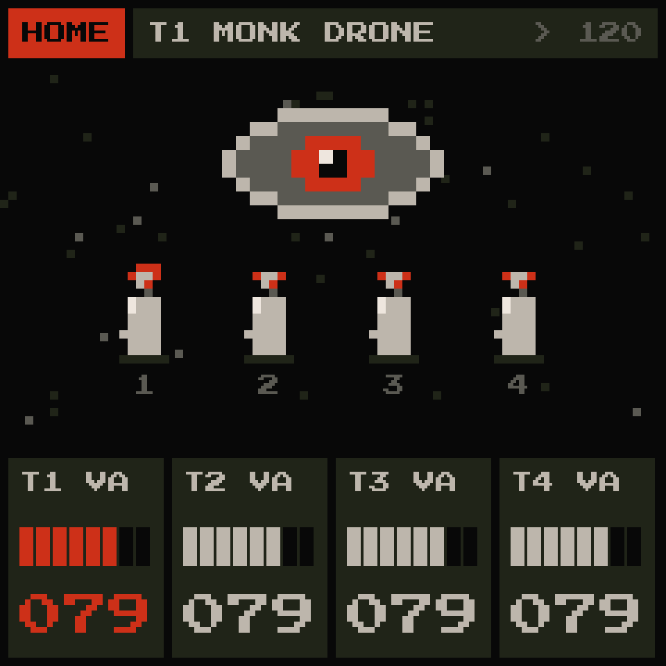

---

## 1. The basics

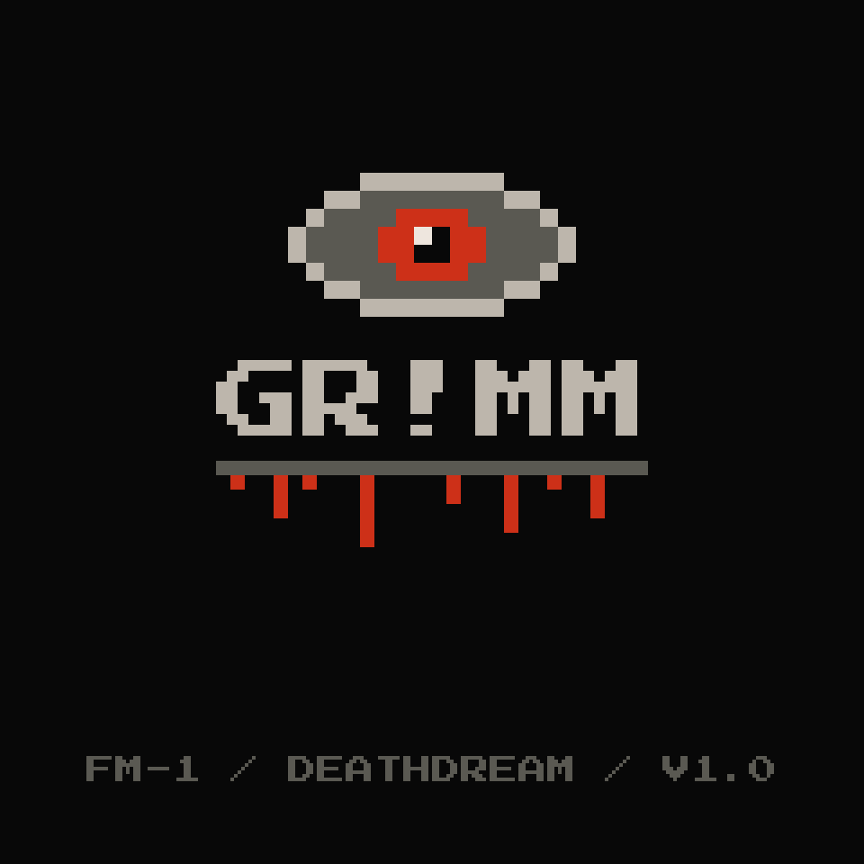

GR!MM has **four tracks (T1–T4)**. Each track plays one sound, has its own sequence, and goes through the shared effects. Six voices are shared by all four tracks.

**The controls you use all the time:**

| Control | What it does |
|---|---|
| **ALGORITHM** knob | Picks the track you're working on (T1–T4). Every page shows that track. |
| **PRESETS** knob | Loads the next or previous sound into the selected track. (On the sequencer pages it sets the tempo instead.) |
| **SELECT** knob | On HOME: tempo. On the sequencer: moves the cursor. |
| **KNOB 1–4** | The four values at the bottom of the screen, whatever page you're on. |
| **MASTER** knob | Volume. |
| **OCT− / OCT+** | Octave down / up. In save menus: back / confirm. |
| **Keys** | Play the selected track. |

**How buttons work:** tap a button to open its first page; tap it again for its next page. The header always shows where you are, e.g. `SEL > CHORD`. Many buttons also do something when **held** while you press a key or turn a knob (see [Combos](#13-combos-at-a-glance)).

**Knobs speed up:** turn slowly for fine steps, quickly to sweep the whole range.

**Saving is automatic:** when the sequencer is stopped and you haven't touched anything for 2.5 seconds, GR!MM saves your work. Switch off any time; it comes back exactly as you left it. (It never saves while something is still sounding, to avoid audio dropouts; the header says `SAVES WHEN SILENT` while it waits.)

**Undo:** hold **EDIT** and press **OCT−** to undo the last edit, **OCT+** to redo it.

**At the first start** after installing, GR!MM writes its four factory samples into any sample slot that is still empty (the boot screen says `INSTALLING SAMPLES` for a few seconds). Slots that already hold something are never touched.

---

## 2. HOME

The main screen: the eye, a candle per track (its flame follows the track's volume and what it's playing) and the four tracks along the bottom. The header shows the selected track and its sound (the factory or saved sound you loaded, by name), with the tempo and the battery level on the right.

**HOME's knobs act on the selected track:**

| KNOB 1 | KNOB 2 | KNOB 3 | KNOB 4 |
|---|---|---|---|
| VOLUME | CUTOFF | RESONANCE | FX |

- **CUTOFF / RESONANCE:** a low-pass filter at the end of the track, for every source. Fully open = no filtering.
- **FX:** turns all three of the track's effect sends up or down together. 0 = dry, 100 % = as set on MIXER 1, 200 % = twice as wet.

Press **HOME** again for the mixer pages:

| Page | KNOB 1 | KNOB 2 | KNOB 3 | KNOB 4 |
|---|---|---|---|---|
| MIXER 1 | LEVEL | DLY SEND | REV SEND | GRAIN SEND |
| MIXER 2 | PAN | | | |

---

## 3. Sounds: EDIT

**EDIT** opens the selected track's sound. Pages: **SOUND → SOURCE** (FM tracks have two more, see below).

### SOURCE page

| KNOB 1 | KNOB 2 |
|---|---|
| SOURCE: VA, FM, SAMPLE, VOICE, WHEEL, PHYS, PHASE | LATCH: OFF / ON |

- **LATCH OFF:** a note sounds while you hold the key, like a normal keyboard.
- **LATCH ON:** press once to start a note, press again to stop it. For drones.

### SOUND page: the source's four knobs

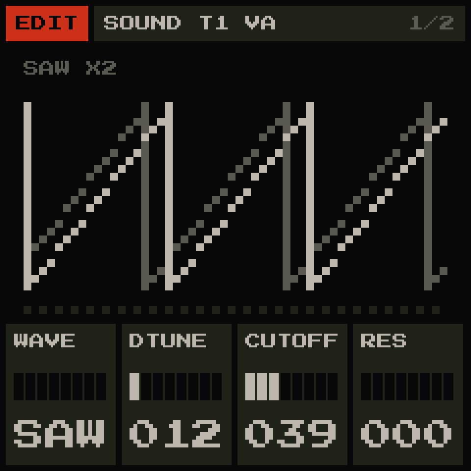

| Source | KNOB 1 | KNOB 2 | KNOB 3 | KNOB 4 | What it is |
|---|---|---|---|---|---|
| **VA** | WAVE | DETUNE | CUTOFF | RESONANCE | Analog-style: saw, square, supersaw |
| **FM** | PATCH | BRIGHT | DECAY | DETUNE | 6-operator FM; PATCH loads a starting point (BELL, ORGAN, SOFT PAD, REED) |
| **SAMPLE** | SLOT | START | LENGTH | REVERSE | A sample slot (1–4) played as a loop; the key sets the speed, like tape |
| **VOICE** | VOWEL | SHIFT | BUZZ | BREATH | Sung vowels; BREATH adds air and noise |
| **WHEEL** | DRAWBARS | PERC | CLICK | DRIVE | Tonewheel organ with rotary speaker |
| **PHYS** | MODEL | STRUCTURE | DAMP | BOW | Bowed and struck strings, bars, plates, membranes |
| **PHASE** | WAVE | WAVE2 | DCW | DETUNE | CZ-style phase distortion |

On PHYS, STRUCTURE and BOW change meaning with the model; the screen shows the current name.

The four sample slots come with GR!MM's factory samples: **1 URCHIN, 2 LEAVE, 3 NIKOLAI, 4 M-SOFT**. Replace them with your own from the [editor](#15-the-editor) (see also [Good to know](#14-good-to-know)).

### FM editor (FM tracks only)

On an FM track, EDIT steps **SOUND → FM ALGO → FM OP → SOURCE**.

| Page | KNOB 1 | KNOB 2 | KNOB 3 | KNOB 4 |
|---|---|---|---|---|
| FM ALGO | ALGO (1–32) | FEEDBACK | OP (picks operator 1–6) | FINE (that operator) |
| FM OP | RATIO | LEVEL | ATTACK | DECAY |

| FM ALGO | FM OP |
|---|---|
| 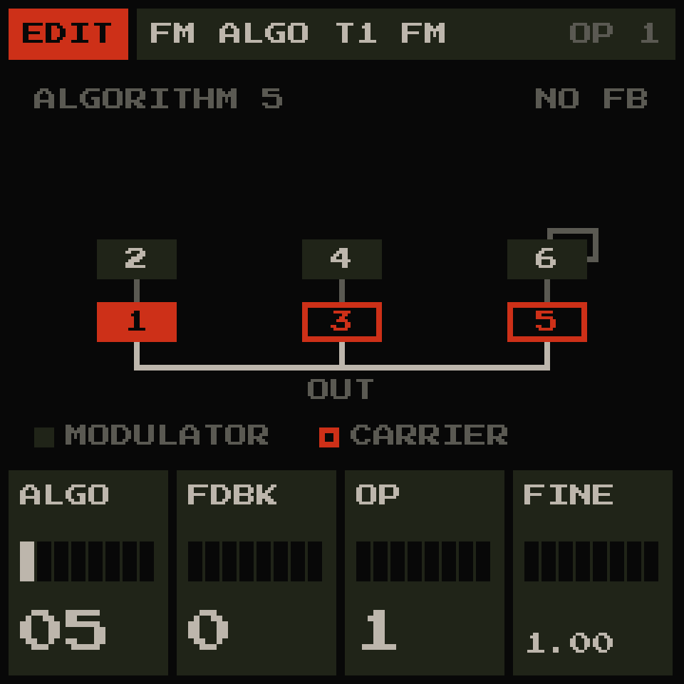 | 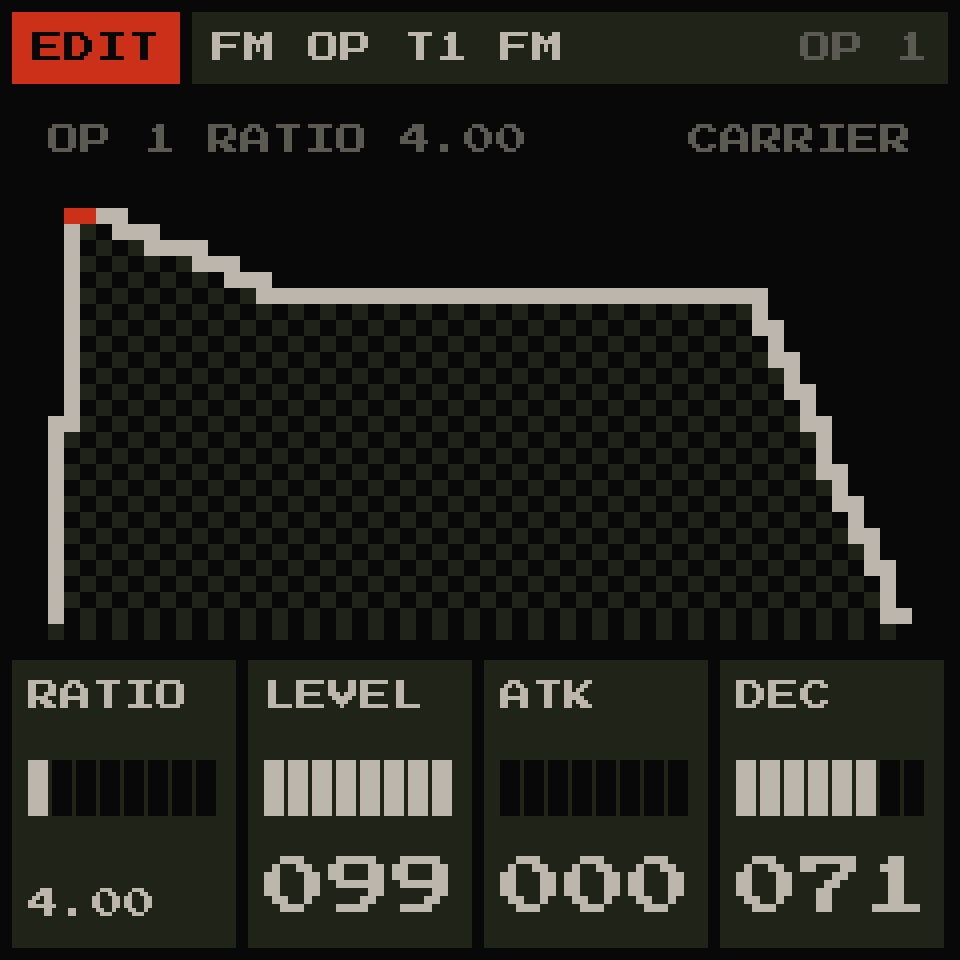 |

The screen draws how the six operators are wired: carriers (the ones you hear) outlined in colour, modulators dark, the selected operator lit. Pick an operator with OP, then shape it on the next page. Turning PATCH on the SOUND page loads a fresh starting point over your edits (undo brings them back).

---

## 4. ENV and LFO

**ENV** (per track): how each note starts and ends.

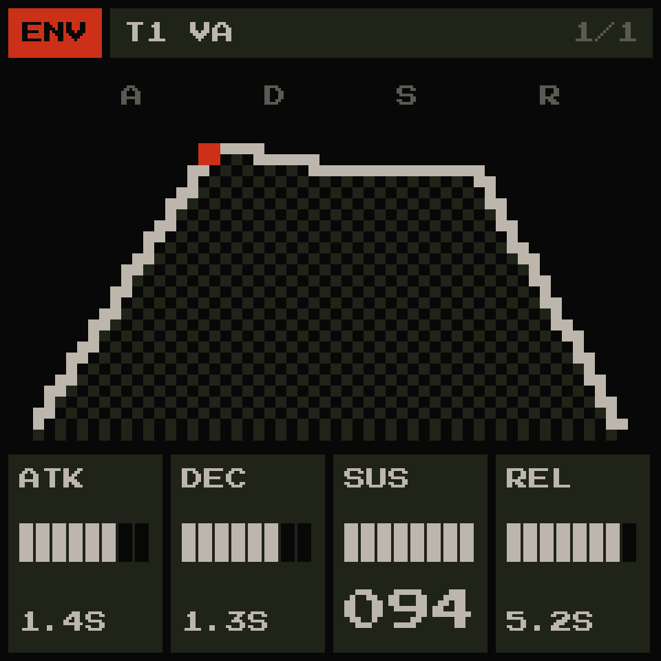

| KNOB 1 | KNOB 2 | KNOB 3 | KNOB 4 |
|---|---|---|---|
| ATTACK (1 ms – 10 s) | DECAY (10 ms – 10 s) | SUSTAIN | RELEASE (10 ms – 20 s) |

**LFO** (per track): slow movement. It runs all the time and never restarts with a note, so drones keep breathing.

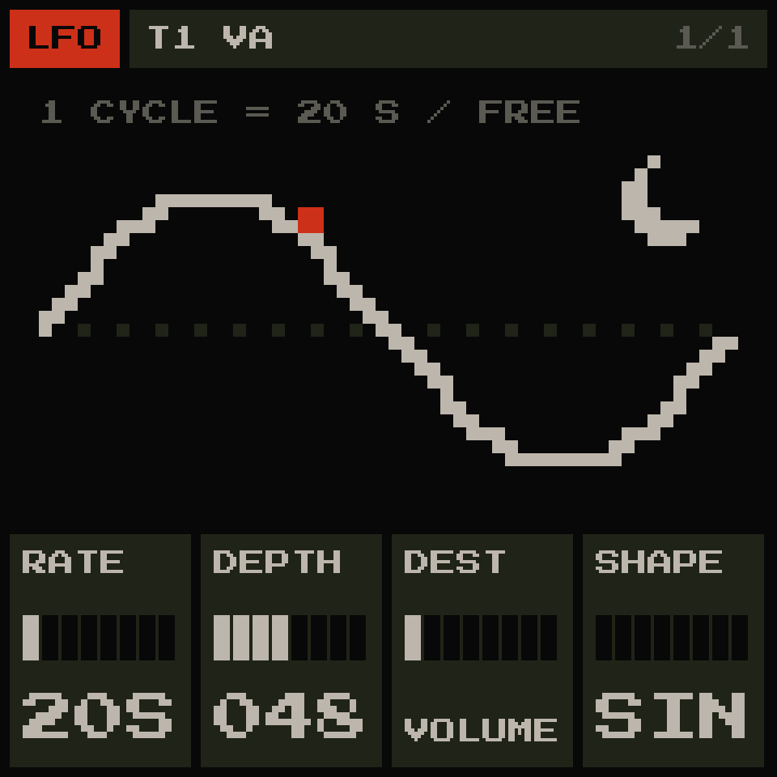

| KNOB 1 | KNOB 2 | KNOB 3 | KNOB 4 |
|---|---|---|---|
| RATE (60 s per cycle – 20 Hz) | DEPTH (0 = off) | DESTINATION | SHAPE |

- **Destinations:** PITCH, VOLUME, PAN, the source's four knobs (by name), REV SEND, GRAIN SEND, the track filter's CUTOFF
- **Shapes:** SINE, TRIANGLE, SAW UP, SAW DOWN, SQUARE, RANDOM (stepped), DRIFT (slow uneven wander)

---

## 5. Scales and chords: SEL

**SEL** opens **SCALE → CHORD**. **Hold SEL** (and let go) to switch **chord mode** on or off for the selected track.

| SCALE | CHORD |
|---|---|
| 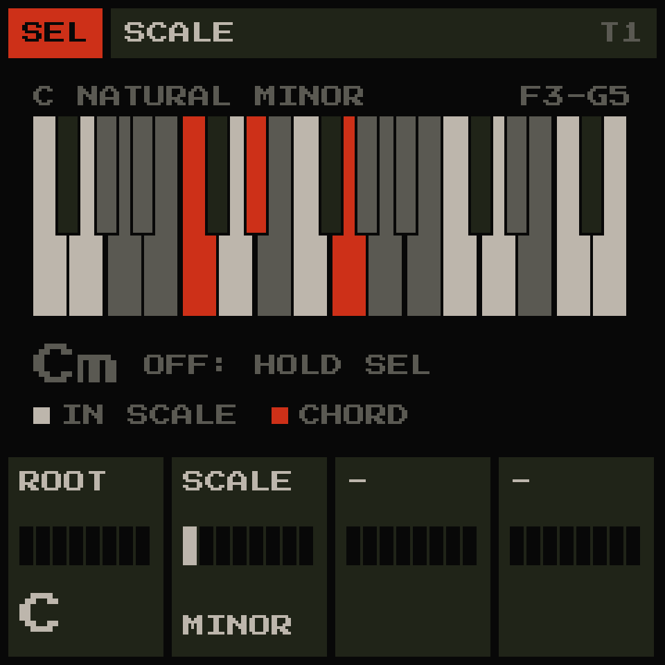 | 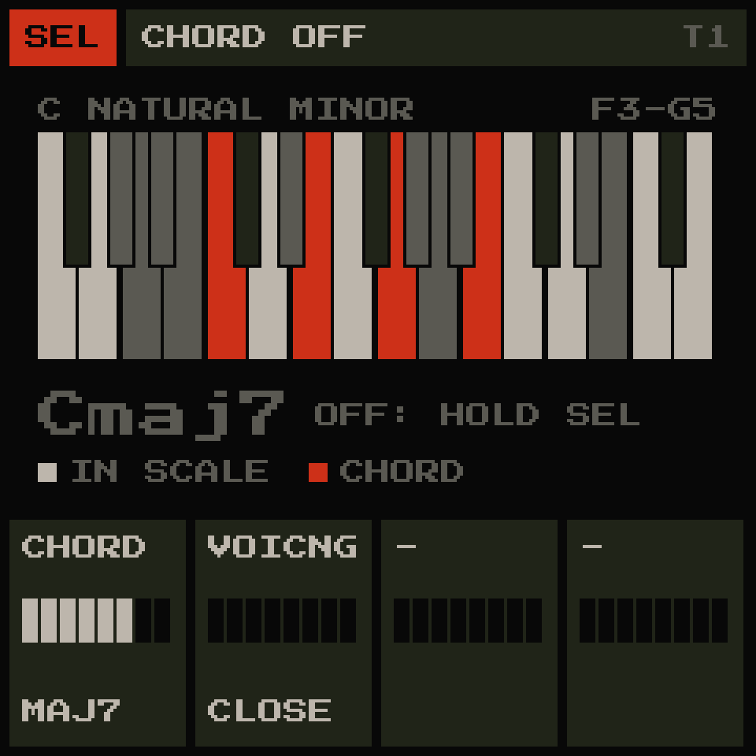 |

| Page | KNOB 1 | KNOB 2 |
|---|---|---|
| SCALE | ROOT (C–B) | SCALE |
| CHORD | CHORD TYPE | VOICING |

- **SCALE** (shared by all tracks): OFF, NATURAL MINOR, MAJOR, DORIAN, PHRYGIAN, LYDIAN, MIXOLYDIAN, LOCRIAN, HARMONIC MINOR, PHRYGIAN DOMINANT, HUNGARIAN MINOR, DOUBLE HARMONIC, MINOR PENTATONIC, MAJOR PENTATONIC. With a scale set, every key snaps to the nearest note in it.
- **CHORD TYPE** (per track): SCALE (the scale's own chord on that note, always in key), MIN, MAJ, SUS2, SUS4, FIFTH, MIN7, MAJ7, DIM, ADD9, CLUSTER
- **VOICING:** CLOSE, OPEN, SPREAD, +OCT, DROP

With chord mode on, one key plays the whole chord. Big chords use more of the six voices; close voicings leave the most room.

---

## 6. Arpeggiator: ARP

**ARP** opens the page; **hold ARP** to switch it on or off for the selected track.

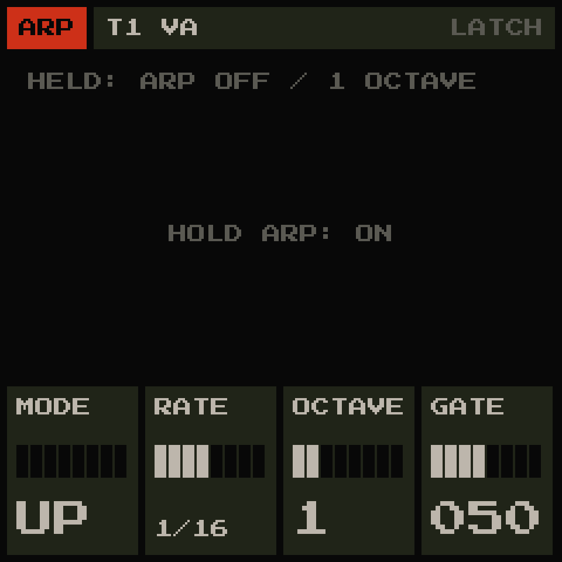

| KNOB 1 | KNOB 2 | KNOB 3 | KNOB 4 |
|---|---|---|---|
| MODE | RATE | OCTAVES (1–4) | GATE |

- **Modes:** UP, DOWN, UP-DOWN, RANDOM, AS PLAYED, CHORD
- **Rates:** 1/1 to 1/32, plus triplets
- It plays the keys you hold (with chord mode: whole chords). With **LATCH ON** it keeps running after you let go; press a key again to take it out.
- It follows the sequencer's clock when playing, otherwise the tempo.

---

## 7. Sequencer: SEQ, PLAY, REC

Every track has its own 64-step pattern. All four play together on one tempo.

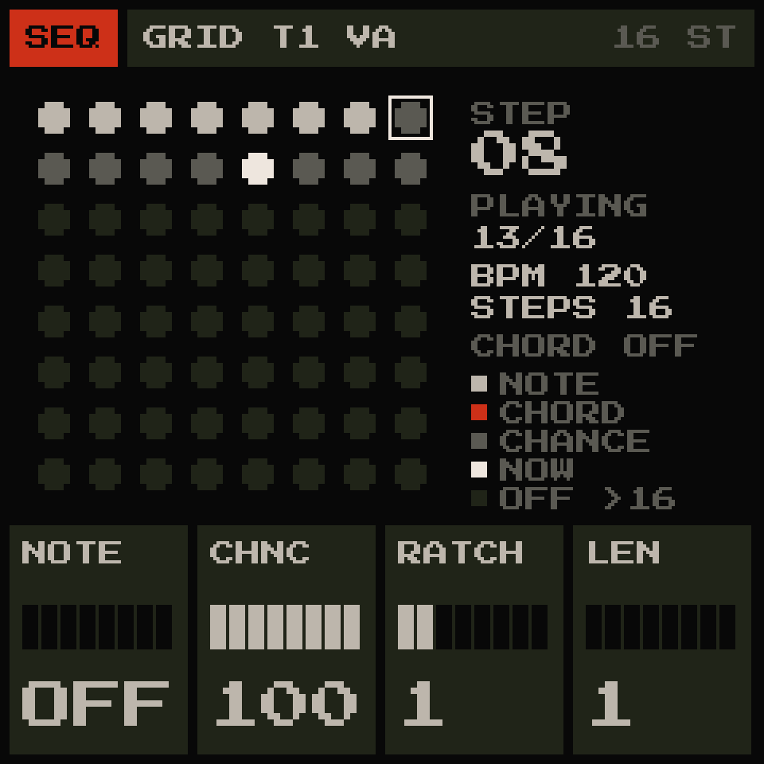

**SEQ** opens **GRID → PATTERN SETTINGS**. **PLAY/STOP** starts and stops. **REC** records.

**GRID** (the selected step):

| KNOB 1 | KNOB 2 | KNOB 3 | KNOB 4 |
|---|---|---|---|
| NOTE (all the way down = OFF) | CHANCE | RATCHET (1–4 hits) | LENGTH (in steps) |

**PATTERN SETTINGS:**

| KNOB 1 | KNOB 2 | KNOB 3 | KNOB 4 |
|---|---|---|---|
| STEPS (1–64) | DIVISION | SWING | PLAY MODE (FORWARD, BACKWARD, PINGPONG, RANDOM) |

**On the sequencer pages:**
- **SELECT** moves the cursor; **hold SEQ + turn SELECT** changes the pattern length.
- **PRESETS** sets the tempo (BPM shows in the panel on the right).

**Recording:**
- **Stopped + REC:** each key writes its note into the selected step and moves on.
- **Playing + REC:** what you play lands on the nearest step.
- With chord mode on, recorded steps keep their chord (shown in colour).

**Step locks:** on the sequencer pages, **hold SEL** and the four knobs become the track's sound knobs. Turn one to lock that value to the selected step (a small mark appears). **Hold SEL + OCT−** clears the step's locks.

**Tools: hold SEQ + a white key** (selected track, all undoable):

| F3 | G3 | A3 | B3 | C4 | D4 | E4 | F4 |
|---|---|---|---|---|---|---|---|
| CLEAR | RANDOM | SHIFT ← | SHIFT → | COPY | PASTE | DOUBLE | MUTATE |

---

## 8. Slots and songs: SAVE, GLO

### Slots A–D

A slot holds the four tracks' sounds, sequences and mix. Tempo and effects are shared.

- **Hold SAVE + C4, D4, E4 or F4:** save into A, B, C or D. If the slot is already used, press the key again within 3 seconds to overwrite.
- **Hold SAVE + F3, G3, A3 or B3:** recall A, B, C or D. While playing, it switches on the next bar. Keys light up for slots that are in use.
- **SAVE → PROJECTS page:** SLOT (A–D) and ACTION (LOAD, SAVE, ERASE, NEW), confirmed with **OCT+**. NEW gives you empty tracks and patterns.

### Your own sounds

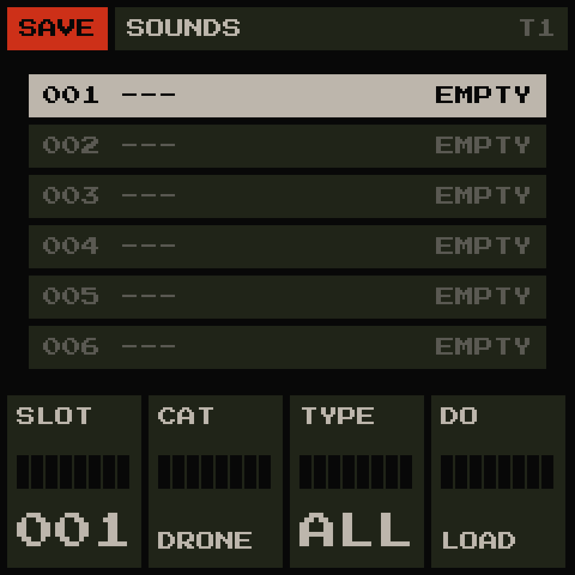

**SAVE → SOUNDS page:** 64 slots for your own sounds (source, its knobs, FM patch, ENV, LFO, latch, chord settings).

| KNOB 1 | KNOB 2 | KNOB 3 | KNOB 4 |
|---|---|---|---|
| SLOT | CATEGORY | TYPE (filters by source) | ACTION: LOAD / SAVE / CLEAR |

Confirm with **OCT+**, back out with **OCT−**. Saved sounds appear in PRESETS after the factory sounds of their category. Factory sounds can't be overwritten.

A saved sound is called by its category and number (`PAD 03`), or by the name you give it in the [editor](#15-the-editor) (up to 10 characters), on this page, in PRESETS and in HOME's header. Saving over a named sound on the FM-1 keeps its name; a sound saved into an empty slot has none until you name it.

### Song mode: GLO

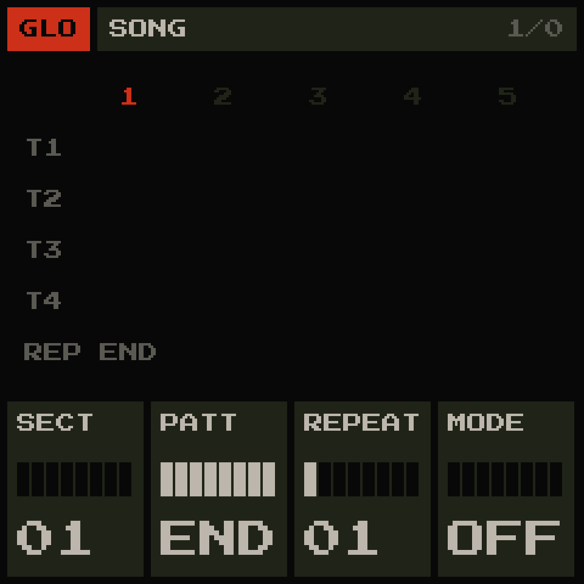

**GLO** opens the **SONG** page: a chain of up to 16 steps, each a slot and how many times it plays.

| KNOB 1 | KNOB 2 | KNOB 3 | KNOB 4 |
|---|---|---|---|
| SECTION (chain step) | PATTERN (A–D / END) | REPEATS (1–16) | MODE |

- **MODE OFF:** PLAY loops the current slot (normal).
- **MODE SONG:** PLAY runs the chain once, then stops.
- **MODE SONG LOOP:** the chain repeats.
- While a song mode is on, the header shows `SONG` on every page.
- **Record a song:** on the SONG page press **REC**, then **PLAY**, and switch slots with hold SAVE + F3–B3. The order you play is written into the chain. STOP ends it.

**Mute and solo: hold GLO + a white key.** F3–B3 mute T1–T4, C4–F4 solo T1–T4.

---

## 9. Effects: FX

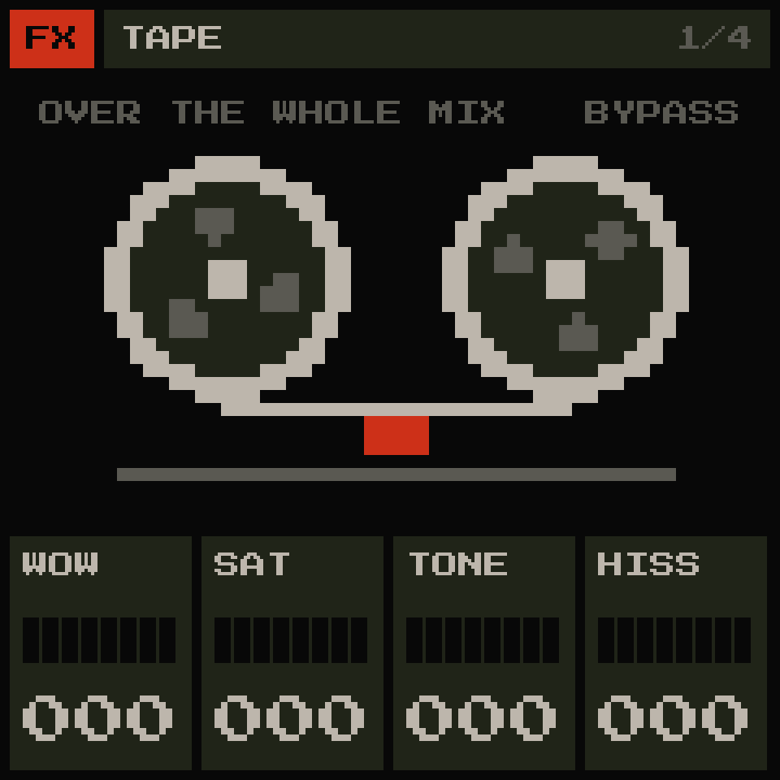

**FX** steps through **TAPE → GRAIN → DELAY → SPACE**. Tracks feed GRAIN, DELAY and SPACE through their sends (MIXER 1, or FX on HOME). TAPE colours everything at the end.

| Page | KNOB 1 | KNOB 2 | KNOB 3 | KNOB 4 |
|---|---|---|---|---|
| TAPE | WOW | SATURATION | TONE | HISS |
| GRAIN | SIZE | DENSITY | SCATTER | MIX |
| DELAY | TIME | FEEDBACK | WEAR | MIX |
| SPACE | SIZE (to ~32 s, then INF) | DAMP | MIX | PRE-DELAY |

GRAIN and DELAY both pour into SPACE. All four TAPE knobs at 0 switches TAPE off completely.

---

## 10. Performance: hold FX

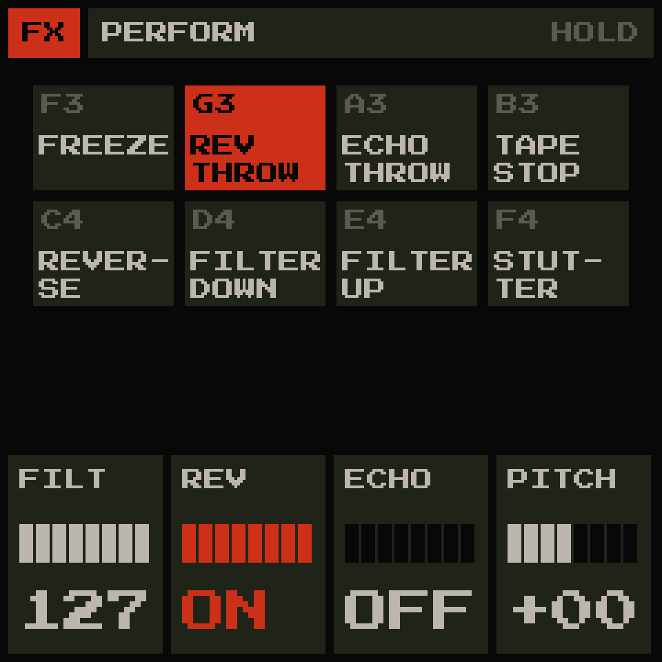

**Hold FX** for a moment and the PERFORM screen appears. Each trick lasts only while you hold its key; the sequencer keeps running underneath, and you land back in time when you let go.

| F3 | G3 | A3 | B3 | C4 | D4 | E4 | F4 |
|---|---|---|---|---|---|---|---|
| FREEZE | REV THROW | ECHO THROW | TAPE STOP | REVERSE | FILTER DOWN | FILTER UP | STUTTER |

FREEZE is the exception: tap it to hold the grain cloud, tap again to release.

---

## 11. System: hold HOME

**Hold HOME** opens **SYSTEM**; press HOME again for **SYSTEM 2**. These are settings for the device, not the project.

| SYSTEM | SYSTEM 2 |
|---|---|
| 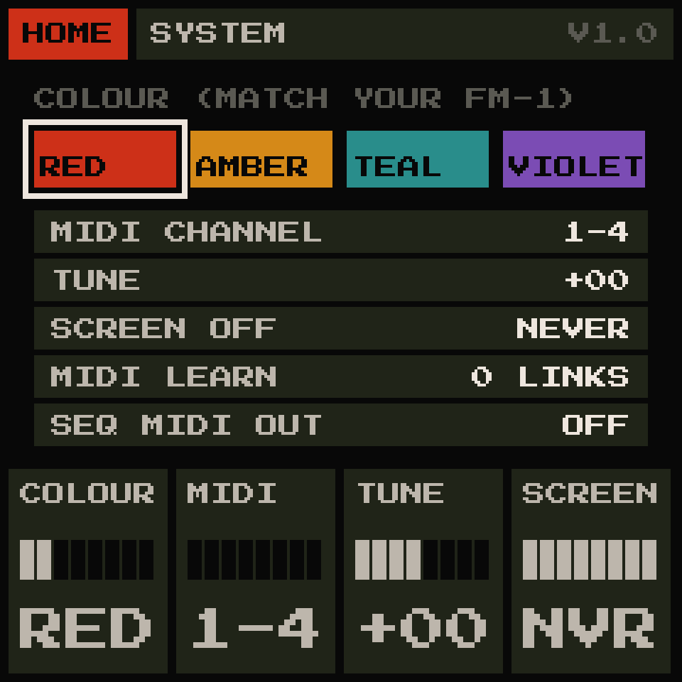 | 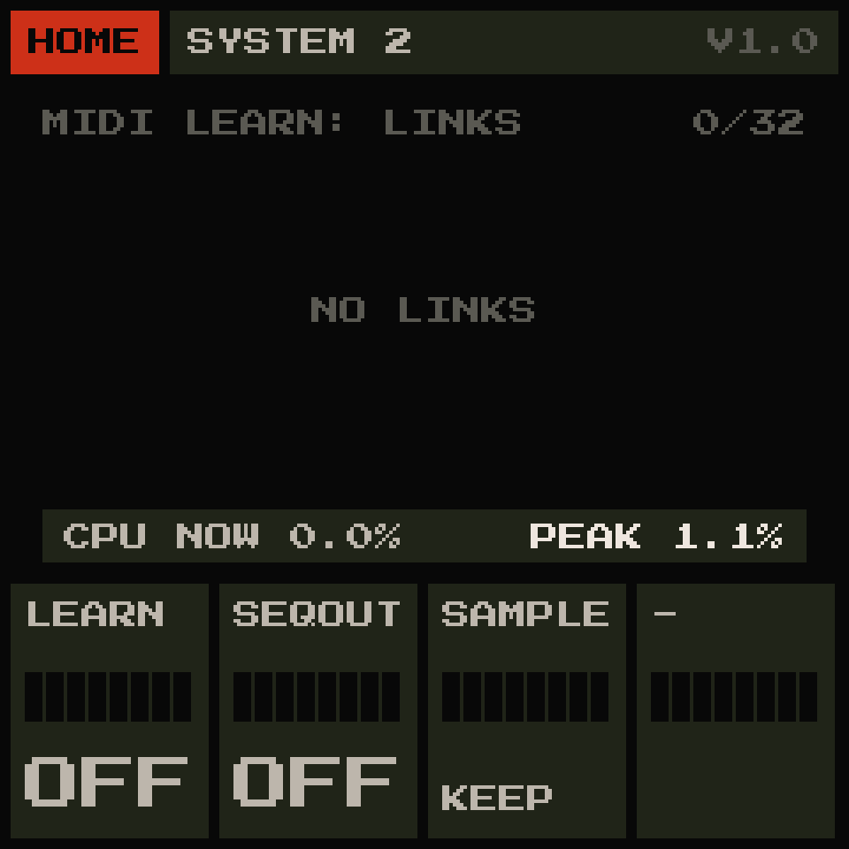 |

| Page | KNOB 1 | KNOB 2 | KNOB 3 | KNOB 4 |
|---|---|---|---|---|
| SYSTEM | COLOUR (red, amber, teal, violet) | MIDI CHANNEL | TUNE (±50 cents) | SCREEN OFF |
| SYSTEM 2 | MIDI LEARN | SEQ MIDI OUT | SAMPLES | |

- **MIDI CHANNEL:** `1-4` puts T1–T4 on channels 1–4 (or start higher, up to `13-16`); `ALL > SEL` sends every channel to the selected track.
- **SCREEN OFF:** the screen goes dark after the chosen time; the music keeps going. Your first touch only wakes it.
- **MIDI LEARN:** set LEARN, turn any knob on the FM-1, then move a knob on your controller. Up to 32 links. CLEAR ALL removes them (confirm with OCT+).
- **SEQ MIDI OUT:** sends the sequencer's and arp's notes out over USB on each track's channel.
- **SAMPLES:** turn it to RESTORE and press **OCT+** to write the four factory samples back into all four sample slots (a few seconds; stop the sequencer and let the sound die out first). **OCT−** keeps your samples.
- SYSTEM 2 also shows the processor load (CPU NOW / PEAK). OCT− + OCT+ together resets PEAK.

---

## 12. Factory sounds

Turn **PRESETS** to step through them by category, then your own.

| Category | Sounds |
|---|---|
| PAD | Crypt Pad, Ash Veil, Frozen Hall, Last Light, Moss, Black Velvet |
| DRONE | Monk Drone, Abyss, Iron Lung, Tomb Hum, Static Prayer, Deep Well |
| BELL | Iron Bell, Funeral Chime, Rust Gong, Glass Harp, Bowed Bell, Shrine |
| VOICE | Choir of Ghosts, Monks, Whisper Chorus, Vigil, Hollow Hymn |
| ORGAN | Funeral Organ, Chapel |
| KEYS | Dead Harpsichord, Music Box, Cathedral Keys, Bone Piano, Wraith, Lantern, Spider Pluck, Lute, Candle |
| OTHER | Haunted Strings, Dungeon Brass, War Horn, Cello Grave, Sorrow Strings |
| TEXTURE | Wind Thru Stone |

---

## 13. Combos at a glance

| Hold | + | Does |
|---|---|---|
| EDIT | OCT− / OCT+ | Undo / redo |
| FX | white keys F3–F4 | Performance tricks (FREEZE … STUTTER) |
| SEL | (alone, let go) | Chord mode on/off |
| SEL | a knob (sequencer pages) | Lock that value to the selected step |
| SEL | OCT− (sequencer pages) | Clear the step's locks |
| SEQ | white keys F3–F4 | Sequencer tools |
| SEQ | turn SELECT | Pattern length |
| SAVE | F3–B3 / C4–F4 | Recall / save slots A–D |
| GLO | F3–B3 / C4–F4 | Mute / solo T1–T4 |
| ARP | (alone) | Arpeggiator on/off |
| HOME | (alone) | System settings |
| — | OCT− + OCT+ together | Reset CPU PEAK |

---

## 14. Good to know

- **Six voices** are shared by all tracks. A new note beyond six takes the oldest one, faded out.
- **Your sounds, slots A–D, settings and samples survive firmware updates.**
- **Samples:** load your own WAV files into the four slots with the [editor](#15-the-editor) (or, optionally, `tools/fm1_sample_upload.py`, see the README). SYSTEM 2's SAMPLES brings the factory samples back.
- **Stuck?** Use the Rescue page on the [FM-1 Firmware Hub](https://thefirmwarehub.com/).

---

## 15. The editor

**[grimmbient.github.io/grimm/editor.html](https://grimmbient.github.io/grimm/editor.html)**, in Chrome or Edge on a computer. Connect the FM-1 over USB, press **CONNECT FM-1 (USB)** and allow MIDI when the browser asks. **TRY WITHOUT AN FM-1** runs GR!MM's own code in the page instead.

- **SOUND EDITOR:** the four tracks' sounds (T1–T4), every setting on screen with the FM-1's names. Every move plays on the FM-1 at once, like turning its knobs, and in the page's own GR!MM, whose screen and keys are beside the sliders (play them with the mouse or the computer keyboard: `Z`–`/`, `S`–`'`, `Q`–`O`). **STORE IN SLOT** saves the sound into one of your 64 slots, with the name you give it.
- **SOUNDS:** your 64 slots and the 40 factory sounds; **LOAD TO T1–T4** puts one on a track. Rename, clear, import and export single sounds.
- **SAMPLES:** drop a WAV on a slot and **UPLOAD** it; **RESTORE FACTORY SAMPLES**.
- **BACKUP:** one file with all your sounds, slots A–D and settings, and a restore that makes a backup of what's there first. (Samples aren't in it: keep their WAV files.)

The FM-1 only writes to its memory (store, upload, restore) while the sequencer is stopped and nothing sounds; the editor tells you when to wait. Nothing is written without you pressing a button.

---

## 16. The demo

**[grimmbient.github.io/grimm/](https://grimmbient.github.io/grimm/)**: the FM-1's panel in your browser, running the same firmware. Press **Switch on**, then play it with the mouse or the computer keyboard. Each button shows its key in its corner.

| Key | Does |
|---|---|
| `Z X C V B N M , . /` | The white keys from F3 |
| `S D F H J L ; '` | The black keys |
| `Q W E R T Y U I O` | B4 to G5 |
| `1 2 3 4 5 6` | FX, SCL (SEL), ENV, LFO, EDIT, GLO |
| `7 8 9 0 - =` | HOME, SAVE, ARP, SEQ, PLAY, REC |
| `[` `]` | OCT−, OCT+ |
| `↑` `↓` | SELECT |
| `←` `→` | ALGORITHM (the track) |

**Combos:** hold a button's key and press other keys, as on the FM-1 (for example hold `8` for SAVE and press `Z`). With the mouse, right-click or Shift-click a button to keep it held until you click it again. Drag or scroll a knob to turn it.
