# GR!MM manual

Version 2.0 · for the M-VAVE FM-1

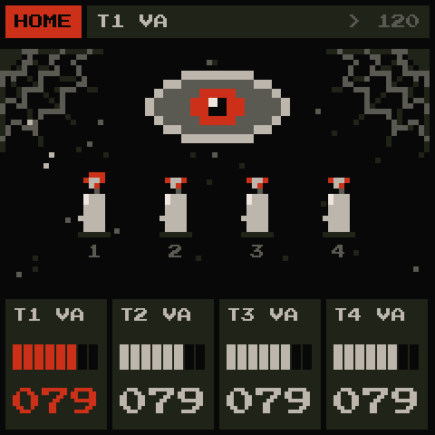

---

## What's new in 2.0

- **Two new effects** on the FX pages: **MASTER**, a stereo filter over everything (LP, HP or BP, at one of three places in the chain), and **DRIVE** (SOFT, FUZZ, CLIP or FOLD, with TONE, MIX and a limiter). See [Effects](#9-effects-fx).
- **Each track's filter** can be a low-pass, high-pass or band-pass, and can sit before or after the effect sends: MIXER 2's **TYPE** and **POS**. See [HOME](#2-home).
- **MIDI:** the **TRS jack is a MIDI input** now; **MIDI clock** in (USB or TRS) and out (USB): SYSTEM 2's **CLOCK**; MIDI CHANNEL **CH n > SEL** plays the selected track from one channel. See [System](#11-system-hold-home).
- **Faster playing:** **hold SEL + OCT+** switches the track's LATCH; **hold REC** (~1 s) clears the track's pattern; SYSTEM 3's **LATCH** decides whether a sound you load brings its own LATCH or always starts unlatched; SYSTEM 3's **VELOCITY** lets MIDI notes play as loud as they were played; SOURCE's **GLIDE** slides each note from the one before.
- **PHASE's LINE 2:** a new page after SOURCE on PHASE tracks gives the second line its own **WAVE** and **DCW**, **RING** (line 1 × line 2) and **NOISE**, as on a Casio CZ; the **PHASE ENV** page after it adds a DCW envelope and a pitch envelope to every note. See [Sounds](#3-sounds-edit).
- **VOICE choirs from real singers:** the VOICE source has a **TYPE** (SOURCE page, KNOB 3): SOLO (one voice, as in 1.0), or a choir of six singers on every note, made from recordings of real singers: GREGORIAN, NUNS or CATHEDRAL. Four choir sounds use them: GREGORIAN (set to FIFTH chords: switch chord mode on to hear parallel fifths), PLAINCHANT, CATHEDRAL CHOIR and NUNS. See [Sounds](#3-sounds-edit).
- **GENERATE:** hold FX and tap a black key to let a track play random notes of the scale by itself, in three moods (DRIFT, PULSE, STORM), each track with its own mode, octave and range, shown on the PERFORM screen. See [Performance](#10-performance-hold-fx).
- **MIXER 1 as six tiles:** LEVEL with a live meter, the DELAY, REVERB and GRAIN sends, and two new per-track sends, **TAPE** and **DRIVE**. TAPE now works per track: only the tracks whose TAPE tile is up go through the tape (0 = untouched), and its **WOW** is random tape slips instead of a steady wobble. See [HOME](#2-home).
- **Warnings:** HOME shows a red **CUT** under a track whose filter is closed and **DRY** under a track whose FX is at 0; SYSTEM 2 counts **USB REC DROPS**; the header says **CPU FULL: NOTE DROPPED** when the FM-1 has too much to play. See [HOME](#2-home) and [System](#11-system-hold-home).
- **Darker screens:** spider webs on HOME, fangs in the VOICE mouth, bats at start-up, and a live level meter on MIXER 1.
- **The editor:** new FX and SETTINGS sections, backups now hold the four samples too, and a NORMALISE switch for samples. See [The editor](#15-the-editor).
- **Cleaner and lighter:** samples uploaded with the editor no longer crackle, PHYS uses much less of the processor (at most four PHYS notes at once), and long backups, DAW loops, latched PHYS notes and the `SAVES WHEN SILENT` message all behave as they should.
- **Headroom:** every sound plays clean at LEVEL 100, chords and four tracks included. The output has 6 dB of headroom, MASTER's top quarter brings the old loudness back, and a limiter at the very end catches any peak, so nothing ever clips. SPACE and DELAY take their sends 6 dB lower (and give them back), so loud chords no longer grind inside the reverb or the echoes. Up to three quarters of MASTER everything is 6 dB quieter than before: turn MASTER further, or your amp, for the old level.
- **Nothing is lost when you update:** your sounds, slots A–D, settings, MIDI LEARN links and samples carry over, and backups from 1.0 restore.

---

## 1. The basics

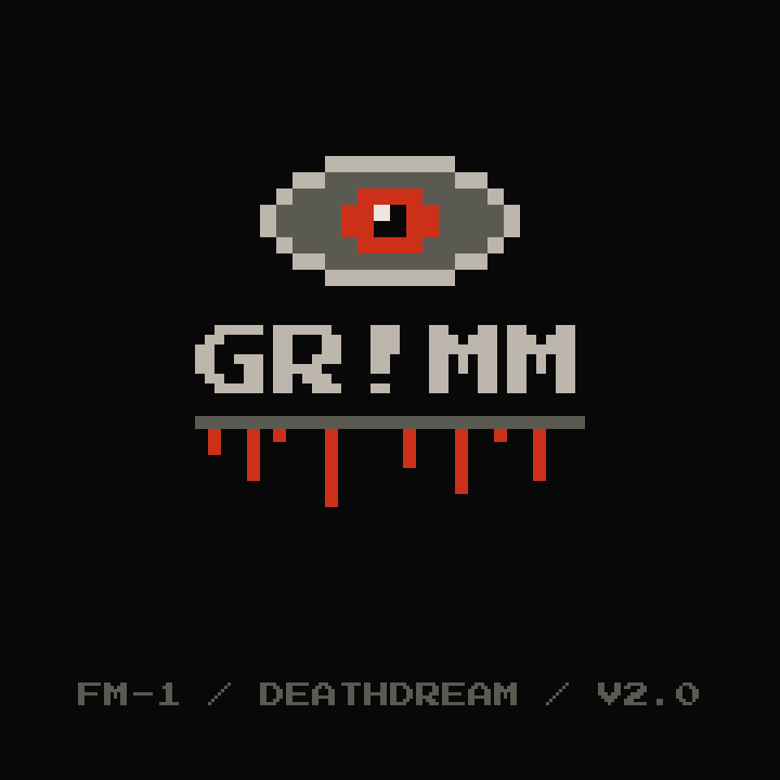

GR!MM has **four tracks (T1–T4)**. Each track plays one sound, has its own sequence, and goes through the shared effects. Six voices are shared by all four tracks.

**The controls you use all the time:**

| Control | What it does |
|---|---|
| **ALGORITHM** knob | Picks the track you're working on (T1–T4). Every page shows that track. |
| **PRESETS** knob | Loads the next or previous sound into the selected track. (On the sequencer pages it sets the tempo instead.) |
| **SELECT** knob | On HOME: tempo. On MIXER 1: picks the tile. On the sequencer: moves the cursor. |
| **KNOB 1–4** | The four values at the bottom of the screen, whatever page you're on. |
| **MASTER** knob | Volume. Its top quarter adds up to 6 dB more (at the very top: as loud as GR!MM 1.0); a limiter keeps the output from ever clipping. |
| **OCT− / OCT+** | Octave down / up. In save menus: back / confirm. |
| **Keys** | Play the selected track. |

**How buttons work:** tap a button to open its first page; tap it again for its next page. The header always shows where you are, e.g. `SEL > CHORD`. Many buttons also do something when **held** while you press a key or turn a knob (see [Combos](#13-combos-at-a-glance)).

**Knobs speed up:** turn slowly for fine steps, quickly to sweep the whole range.

**Saving is automatic:** when the sequencer is stopped and you haven't touched anything for 2.5 seconds, GR!MM saves your work. Switch off any time; it comes back exactly as you left it. (It never saves while something is still sounding, to avoid audio dropouts; the header says `SAVES WHEN SILENT` for 2 seconds when it starts waiting, then gets out of the way; the save still waits. With an effect tail that never ends (DELAY feeding back, SPACE on INF, GRAIN frozen) it would wait for ever, so saves, sample uploads and editor writes go ahead 10 seconds after the last note. While a computer records the FM-1 over USB, autosave waits until you have left the FM-1 alone for 60 seconds, and saves straight away when the recording stops.)

**Undo:** hold **EDIT** and press **OCT−** to undo the last edit, **OCT+** to redo it.

**At the first start** after installing, GR!MM writes its four factory samples into any sample slot that is still empty (the boot screen says `INSTALLING SAMPLES` for a few seconds). A few seconds later it does the same for any slot that holds something that cannot play, such as data left by another firmware or an upload that was cut short (the header says `SAMPLES RESTORED: 1 2`). A slot with a working sample is never touched.

---

## 2. HOME

The main screen: the eye, two spider webs in the top corners (dew glints on them, more the louder it plays), a candle per track (its flame follows the track's volume and what it's playing) and the four tracks along the bottom. The header shows the selected track and its sound (the factory or saved sound you loaded, by name), with the tempo and the battery level on the right.

**HOME's knobs act on the selected track:**

| KNOB 1 | KNOB 2 | KNOB 3 | KNOB 4 |
|---|---|---|---|
| VOLUME | CUTOFF | RESONANCE | FX |

- **CUTOFF / RESONANCE:** a filter at the end of the track, for every source: a low-pass unless MIXER 2 says otherwise. Fully open = no filtering.
- **FX:** turns all five of the track's effect sends (MIXER 1's DELAY, REVERB, TAPE, GRAIN, DRIVE) up or down together. 0 = dry, 100 % = as set on MIXER 1, 200 % = twice as wet.
- **CUT and DRY:** a small red **CUT** under a track's name on HOME means its filter is closed (nothing gets through); a red **DRY** means its FX is at 0, so it gets no effects although a send is up. On MIXER 1 such a track's send tiles are dimmed and show **FX0**.

Press **HOME** again for the mixer pages:

| Page | KNOB 1 | KNOB 2 | KNOB 3 | KNOB 4 |
|---|---|---|---|---|
| MIXER 1 | the tile SELECT picks | | | |
| MIXER 2 | PAN | TYPE | POS | |

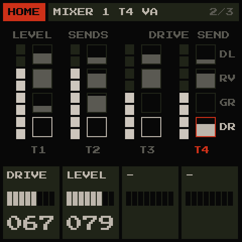

- **MIXER 1** is six tiles for the selected track: **LEVEL**, **DELAY**, **REVERB** on top, **TAPE**, **GRAIN**, **DRIVE** below. Turn **SELECT** to move the red outline from tile to tile; **KNOB 1** sets the outlined tile (its bar and number turn red). **ALGORITHM** picks the track, as everywhere. The other knobs do nothing here.
- **LEVEL:** the bar is a live meter: it moves with the track's sound, and its top two segments turn red at the peak. The meter's colour shows the LEVEL (dim grey when low, white when full). The small notch under it marks where LEVEL is set; the number is the LEVEL setting.
- **DELAY, REVERB, GRAIN:** how much of the track goes to DELAY, SPACE and GRAIN.
- **DRIVE send:** sends the track to a drive of its own, which joins the dry mix in the middle (not panned); the driven sound isn't sent on to GRAIN, DELAY or SPACE, but MASTER and the DRIVE page still act on it. It uses the DRIVE page's **TYPE** and **TONE**; the send is how hard the track hits it. It works even when the DRIVE page's AMOUNT is 0, so you can drive one track and leave the others clean. All DRIVE sends at 0 = off completely.
- **TAPE:** how much of this track goes through the tape. **0 = untouched**: the track doesn't go through the tape at all. The tape sits first on the track, so the track's other sends (DELAY, REVERB, GRAIN, DRIVE) hear the taped sound. It uses the TAPE page's **WOW**, **SATURATION** and **TONE**; **HISS** plays while at least one track uses the tape. **WOW** is random tape slips on the track's notes: the pitch stays steady, then every few seconds the tape briefly jerks or sags off and back. The TAPE page's knob only sets how big the slips are. All TAPE tiles at 0 = the tape is off completely.
- **TYPE** (MIXER 2): the track filter is a low-pass (`LP`), high-pass (`HP`) or band-pass (`BP`). `LP` open (CUTOFF at the top) or `HP` open (CUTOFF at the bottom) means no filtering. A band-pass is gentle at RESONANCE 0 and narrows as you turn it up.
- **POS** (MIXER 2): `PRE`: the effect sends hear the filtered sound (as GR!MM 1.0). `POST`: only the track's dry sound is filtered; GRAIN, DELAY and SPACE hear it unfiltered (a dark track with a bright reverb, say).

---

## 3. Sounds: EDIT

**EDIT** opens the selected track's sound. Pages: **SOUND → SOURCE** (FM tracks have two more, see below).

### SOURCE page

| KNOB 1 | KNOB 2 | KNOB 3 | KNOB 4 |
|---|---|---|---|
| SOURCE: VA, FM, SAMPLE, VOICE, WHEEL, PHYS, PHASE | LATCH: OFF / ON | TYPE (VOICE only): SOLO, GREGORIAN, NUNS, CATHEDRAL | GLIDE: OFF, 10 MS – 2.5 S |

- **LATCH OFF:** a note sounds while you hold the key, like a normal keyboard.
- **LATCH ON:** press once to start a note, press again to stop it. For drones. A note latched from MIDI (a DAW, a keyboard) stops with its key on the FM-1 too, and switching LATCH off stops every note of the track, wherever it came from. (After a DAW's STOP, notes it latched stay on: with LATCH ON a note-off doesn't end a note, as in GR!MM 1.0.)
- **Hold SEL + OCT+** switches the selected track's LATCH on or off from any page, while you play. Switching it off lets go of the latched notes.
- A sound you load brings its own LATCH, as in GR!MM 1.0, unless SYSTEM 3's LATCH is set to ALWAYS OFF: then a sound you load sets the track's LATCH off. Either way, EDIT's LATCH and SEL + OCT+ work at any time.
- **GLIDE** (portamento): each new note starts at the pitch of the track's last note and slides to its own, fast at first, then easing in. The knob sets how long the slide takes, from 10 ms (a quick scoop) to about 2.5 s (a slow siren). OFF (the default, and every sound made before) jumps straight to the note, as in 1.0. It works with every source, with chords (every note of the chord slides by the same amount), the sequencer, ARP and GENERATE, and is saved with the sound.

### SOUND page: the source's four knobs

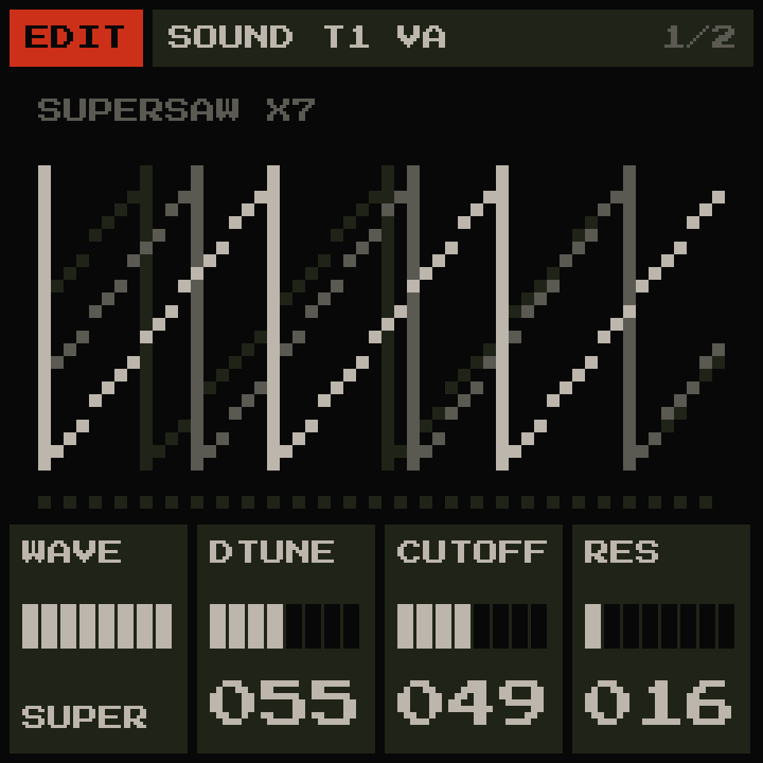

| Source | KNOB 1 | KNOB 2 | KNOB 3 | KNOB 4 | What it is |
|---|---|---|---|---|---|
| **VA** | WAVE | DETUNE | CUTOFF | RESONANCE | Analog-style: saw, square, supersaw |
| **FM** | PATCH | BRIGHT | DECAY | DETUNE | 6-operator FM; PATCH loads a starting point (BELL, ORGAN, SOFT PAD, REED) |
| **SAMPLE** | SLOT | START | LENGTH | REVERSE | A sample slot (1–4) played as a loop; the key sets the speed, like tape |
| **VOICE** | VOWEL | SHIFT | BUZZ | BREATH | Sung vowels; BREATH adds air and noise |
| **WHEEL** | DRAWBARS | PERC | CLICK | DRIVE | Tonewheel organ with rotary speaker |
| **PHYS** | MODEL | STRUCTURE | DAMP | BOW | Bowed and struck strings, bars, plates, membranes |
| **PHASE** | WAVE | WAVE2 | DCW | DETUNE | CZ-style phase distortion |

On PHYS, STRUCTURE and BOW change meaning with the model; the screen shows the current name.

**VOICE's TYPE** (SOURCE page, KNOB 3) turns each note into a choir of six singers. SOLO is VOICE's own synthesized voice; the choirs are made from **recordings of real singers** (single cycles of their sung vowels, like the vocal wavetables of a "vocal pad" synth), each singer a little out of tune with the others, drifting a little on its own, with a vibrato and a slow sway of their own:

| TYPE | Who sings each note |
|---|---|
| SOLO | One synthesized voice, as in GR!MM 1.0 (the default; every sound made before 2.0 is SOLO) |
| GREGORIAN | Six men (three singers, two parts each), almost no vibrato |
| NUNS | Six women (three singers, two parts each), a gentle vibrato |
| CATHEDRAL | Three men and three women an octave above them, a gentle vibrato |

On a choir, the knobs do this:

- **VOWEL** morphs between the singers' A, E, I, O and U (E, I and U made a little clearer than the recordings have them; it glides as you turn it, without steps).
- **SHIFT** spreads the singers: −12 = all in tune (unison), 0 (the middle) = as designed, +12 = twice as wide.
- **BUZZ** is the tone: low = dark and soft, high = open and bright.
- **BREATH** adds breath noise; at the very top the singing fades into a whisper.

With chord mode, every note of the chord is a choir. The men sound most natural from about F#2 to F#4, the women from about F#3 to F#5 (each singer was recorded at two pitches, men C3 and C4, women C4 and C5; further from them the vowels get boomier or thinner). A choir uses a little more of the processor than SOLO, and a little more again while VOWEL sits between two vowels.

**Reverb for the choirs** (a sound doesn't store these: set them on the FX pages and MIXER 1): SPACE **SIZE** about 10 s, **DAMP** about 47 % (a darker tail), **MIX** 79 % (as it starts), **PRE-DELAY** about 40 ms, and the track's **REVERB** on MIXER 1 at about 80 %. For a long, cathedral wash, SIZE up to 15–20 s.

The choir recordings are from **VocalSet** (Wilkins, Seetharaman, Wahl, Pardo, Northwestern University, 2018, <https://doi.org/10.5281/zenodo.1442513>), licensed under Creative Commons Attribution 4.0 (<https://creativecommons.org/licenses/by/4.0/>); GR!MM made single cycles from them (see LICENSING.md).

### PHASE's LINE 2 page

On a **PHASE** track, EDIT has one more page after SOURCE: **LINE 2**. PHASE plays two lines, like a Casio CZ: line 1 is WAVE / WAVE2 bent by DCW; line 2 joins in when DETUNE is up (a copy of line 1, DETUNE cents higher) or when this page asks for it, and here it can have a wave and a bend of its own (as the CZ's two lines). Everything on it is saved with the sound (and with the project); every sound made before has it all off, so it sounds as it did.

| KNOB 1 | KNOB 2 | KNOB 3 | KNOB 4 |
|---|---|---|---|
| WAVE: SAME, SAW, SQR, PLS, DSIN, SPLS, RSAW, RTRI, RTRP | DCW: SAME, 1–100 % | RING: OFF / ON | NOISE: OFF / ON |

- **WAVE:** line 2's wave. SAME (the default) plays line 1's (with WAVE2 every other cycle, as before); any other wave plays that one every cycle, mixed with line 1. It brings line 2 in by itself, at line 1's pitch unless DETUNE is up: a SAW over a DSIN, an RTRI over a SQR…
- **DCW:** line 2's bend. SAME (the default) follows line 1's DCW; any other value bends line 2 that much, so one line can stay soft while the other bites. It also brings line 2 in by itself.

- **RING:** line 1 × line 2 (ring modulation, as the CZ's) instead of the two mixed: metallic, bell-like, clangorous. Try it with DETUNE up: the further apart the two lines, the stranger.
- **NOISE:** noise roughens line 2 (as the CZ's noise modulation): breathy, gritty, for winds, ghosts and broken radios. It brings line 2 in by itself; with RING too, the noise rings against line 1.

### PHASE's PHASE ENV page

After LINE 2 comes **PHASE ENV**: two envelopes that every PHASE note plays by itself. Each one jumps at the start of the note and then decays back, as fast or as slow as its DECAY says. With both at OFF (the default, and every sound made before) PHASE sounds as it did.

| KNOB 1 | KNOB 2 | KNOB 3 | KNOB 4 |
|---|---|---|---|
| DCW ENV: OFF, 1–100 % | DCW DECAY: 10 MS – 9.7 S | PITCH ENV: −64 … +63 ST (OFF at 0) | PITCH DECAY: 10 MS – 9.7 S |

- **DCW ENV:** how much brighter each note starts: the bend jumps up by this much (on top of DCW, and of LINE 2's own DCW) and falls back over **DCW DECAY**. Short: a pluck, a bell's strike; long: a slow sweep that closes as the note sounds.
- **PITCH ENV:** each note starts this many semitones away (+ above, − below) and slides back over **PITCH DECAY**. A few semitones and a short decay: a blip, a zap, a kick; an octave or two and a long one: a falling siren.
- The screen draws both: DCW on the left (up from the floor), PITCH on the right (up or down from the middle), over about a second.

| PHYS MODEL | What it is | STRUCTURE | DAMP | BOW |
|---|---|---|---|---|
| MODAL | a bar, bell or plate: a set of resonating modes | harmonic (bar) → inharmonic (bell, metal) | how long it rings: low = short, high = long | 0: struck; up: excited by a stream of tiny random strikes, so it keeps sounding |
| STRING | a plucked string (Karplus-Strong) | a buzzy bridge → a stiff string (its overtones pulled out of tune) | as MODAL | 0: plucked; up: excited by noise, so it keeps sounding |
| MEMBRANE | a struck drum head | HARM: an ideal head → a tuned (tabla-like) one | as MODAL | BEND: the pitch drop after the strike (no bowing) |
| SYMPATH | a plucked string with three strings ringing along | CHORD of the sympathetic strings | as MODAL | BUZZ: a buzzing bridge (no bowing) |

PHYS's "bow" is not a smooth violin bow: it keeps the model sounding with many tiny random hits (MODAL) or noise (STRING). With DAMP low each hit dies at once and you hear a stream of little plucks; turn **DAMP up** (long ring) for a smooth, sustained, swelling tone. MEMBRANE and SYMPATH can't be bowed: on them the fourth knob is BEND and BUZZ. A bowed STRING with STRUCTURE high can sound unsteady and break up while you hold it: that is the string model itself (GR!MM 1.0 sounds the same).

The four sample slots come with GR!MM's factory samples: **1 URCHIN, 2 LEAVE, 3 NIKOLAI, 4 M-SOFT**. Replace them with your own from the [editor](#15-the-editor) (see also [Good to know](#14-good-to-know)).

### FM editor (FM tracks only)

On an FM track, EDIT steps **SOUND → FM ALGO → FM OP → SOURCE**.

| Page | KNOB 1 | KNOB 2 | KNOB 3 | KNOB 4 |
|---|---|---|---|---|
| FM ALGO | ALGO (1–32) | FEEDBACK | OP (picks operator 1–6) | FINE (that operator) |
| FM OP | RATIO | LEVEL | ATTACK | DECAY |

| FM ALGO | FM OP |
|---|---|
| 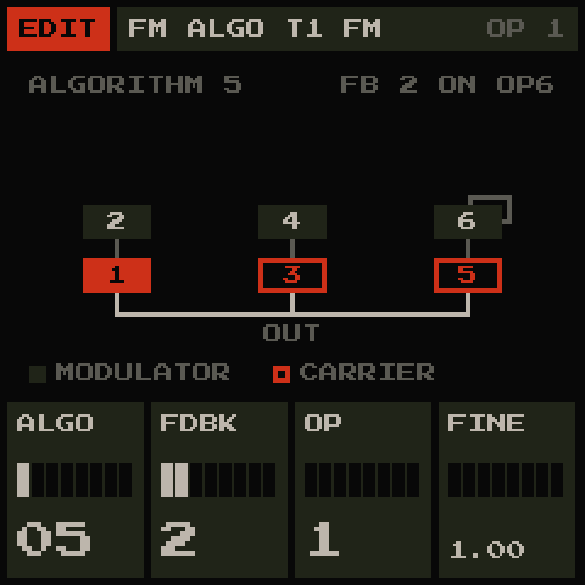 | 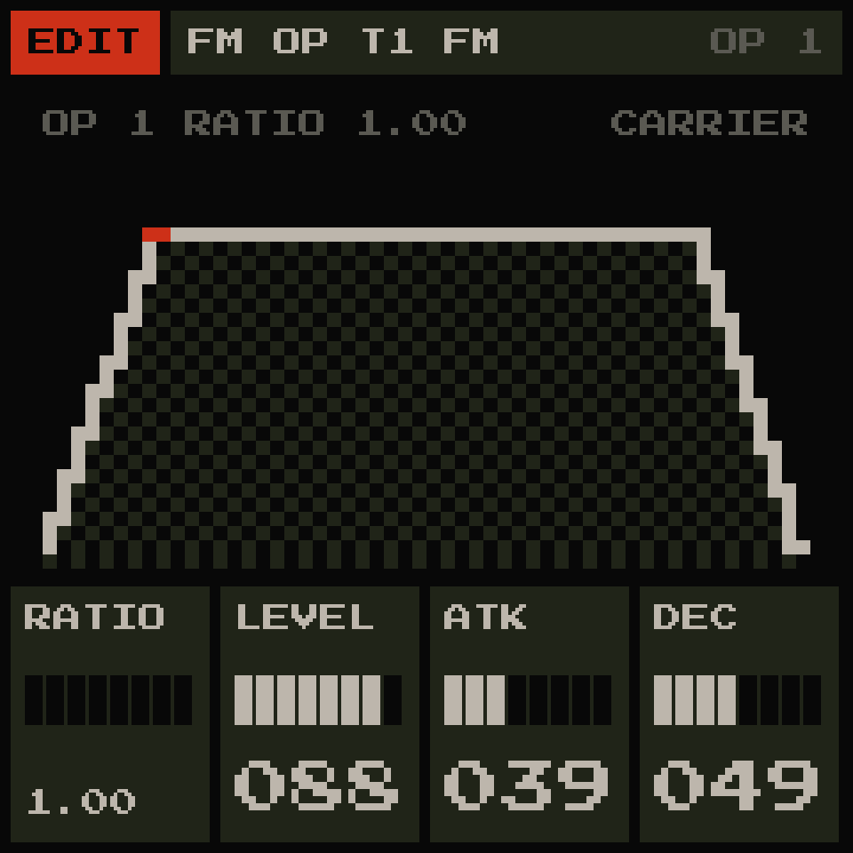 |

The screen draws how the six operators are wired: carriers (the ones you hear) outlined in colour, modulators dark, the selected operator lit. Pick an operator with OP, then shape it on the next page. Turning PATCH on the SOUND page loads a fresh starting point over your edits (undo brings them back).

---

## 4. ENV and LFO

**ENV** (per track): how each note starts and ends.

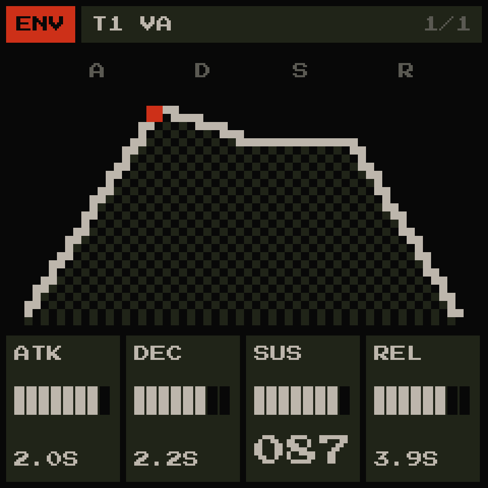

| KNOB 1 | KNOB 2 | KNOB 3 | KNOB 4 |
|---|---|---|---|
| ATTACK (1 ms – 10 s) | DECAY (10 ms – 10 s) | SUSTAIN | RELEASE (10 ms – 20 s) |

**LFO** (per track): slow movement. It runs all the time and never restarts with a note, so drones keep breathing.

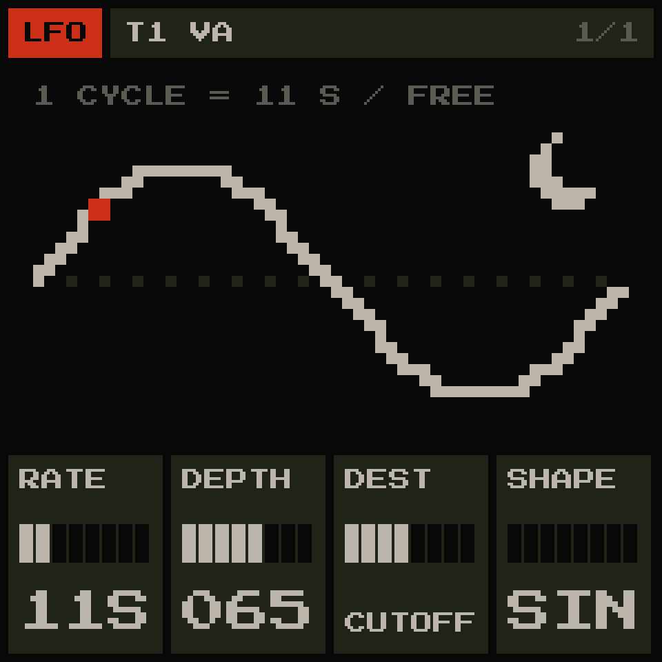

| KNOB 1 | KNOB 2 | KNOB 3 | KNOB 4 |
|---|---|---|---|
| RATE (60 s per cycle – 20 Hz) | DEPTH (0 = off) | DESTINATION | SHAPE |

- **Destinations:** PITCH, VOLUME, PAN, the source's four knobs (by name), REV SEND, GRAIN SEND, the track filter's CUTOFF
- **Shapes:** SINE, TRIANGLE, SAW UP, SAW DOWN, SQUARE, RANDOM (stepped), DRIFT (slow uneven wander)

---

## 5. Scales and chords: SEL

**SEL** opens **SCALE → CHORD**. **Hold SEL** (and let go) to switch **chord mode** on or off for the selected track.

| SCALE | CHORD |
|---|---|
| 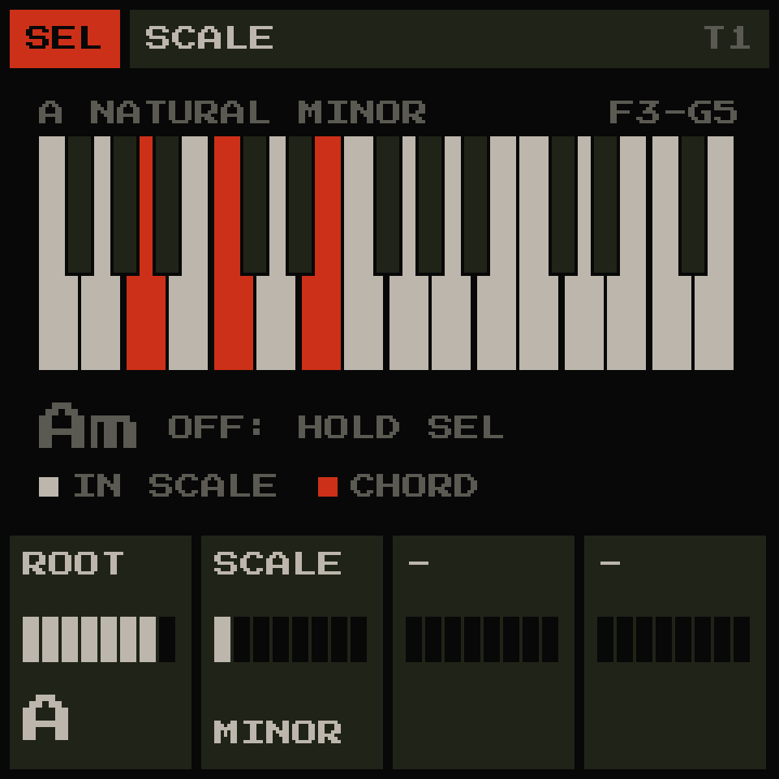 | 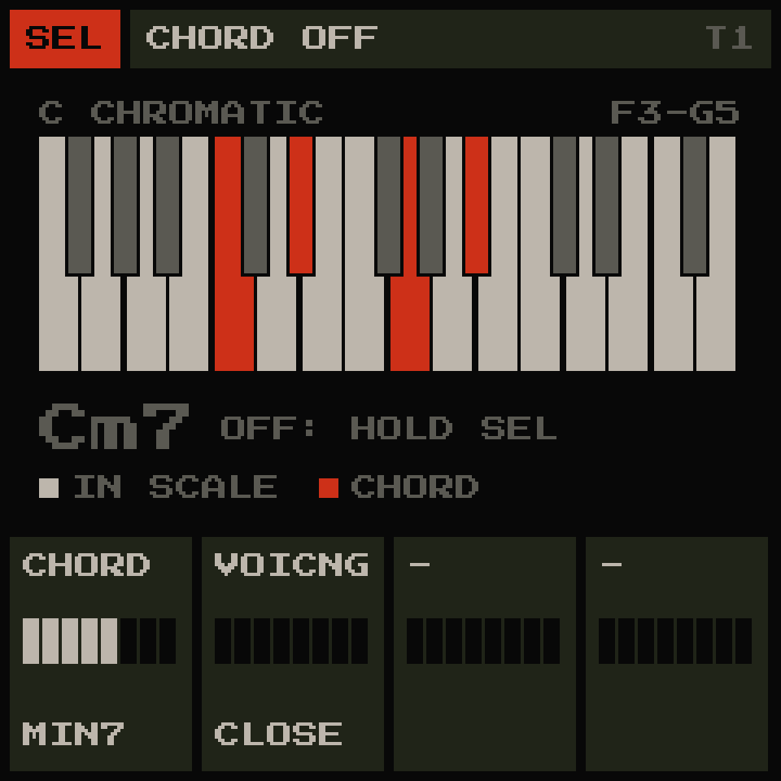 |

| Page | KNOB 1 | KNOB 2 |
|---|---|---|
| SCALE | ROOT (C–B) | SCALE |
| CHORD | CHORD TYPE | VOICING |

- **SCALE** (shared by all tracks): OFF, NATURAL MINOR, MAJOR, DORIAN, PHRYGIAN, LYDIAN, MIXOLYDIAN, LOCRIAN, HARMONIC MINOR, PHRYGIAN DOMINANT, HUNGARIAN MINOR, DOUBLE HARMONIC, MINOR PENTATONIC, MAJOR PENTATONIC. With a scale set, every key snaps to the nearest note in it.
- **CHORD TYPE** (per track): SCALE (the scale's own chord on that note, always in key), MIN, MAJ, SUS2, SUS4, FIFTH, MIN7, MAJ7, DIM, ADD9, CLUSTER
- **VOICING:** CLOSE, OPEN, SPREAD, +OCT, DROP

With chord mode on, one key plays the whole chord. Big chords use more of the six voices; close voicings leave the most room.

---

## 6. Arpeggiator: ARP

**ARP** opens the page; **hold ARP** to switch it on or off for the selected track.

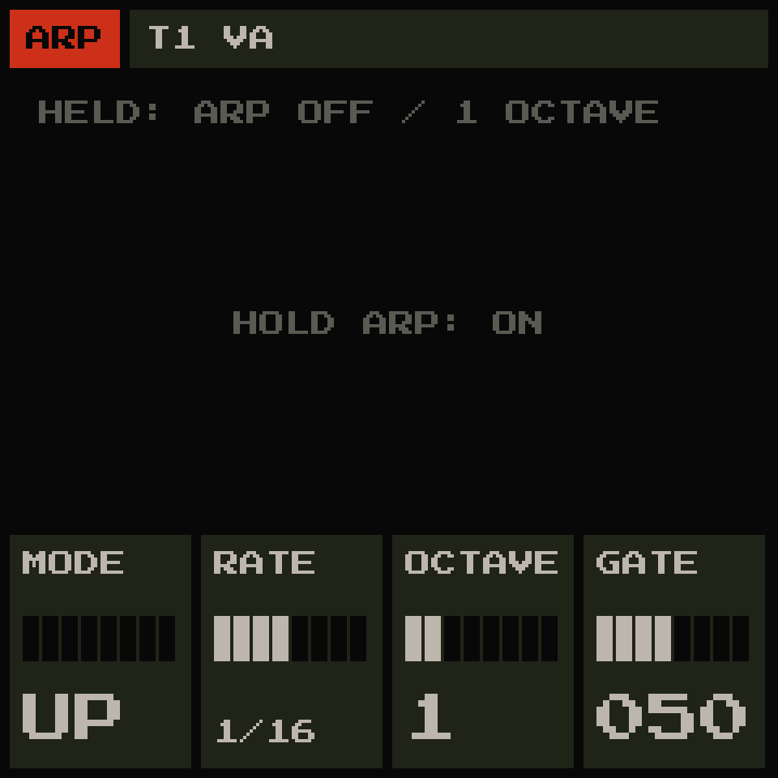

| KNOB 1 | KNOB 2 | KNOB 3 | KNOB 4 |
|---|---|---|---|
| MODE | RATE | OCTAVES (1–4) | GATE |

- **Modes:** UP, DOWN, UP-DOWN, RANDOM, AS PLAYED, CHORD
- **Rates:** 1/1 to 1/32, plus triplets
- It plays the keys you hold (with chord mode: whole chords). With **LATCH ON** it keeps running after you let go; press a key again to take it out.
- It follows the sequencer's clock when playing, otherwise the tempo.

---

## 7. Sequencer: SEQ, PLAY, REC

Every track has its own 64-step pattern. All four play together on one tempo.

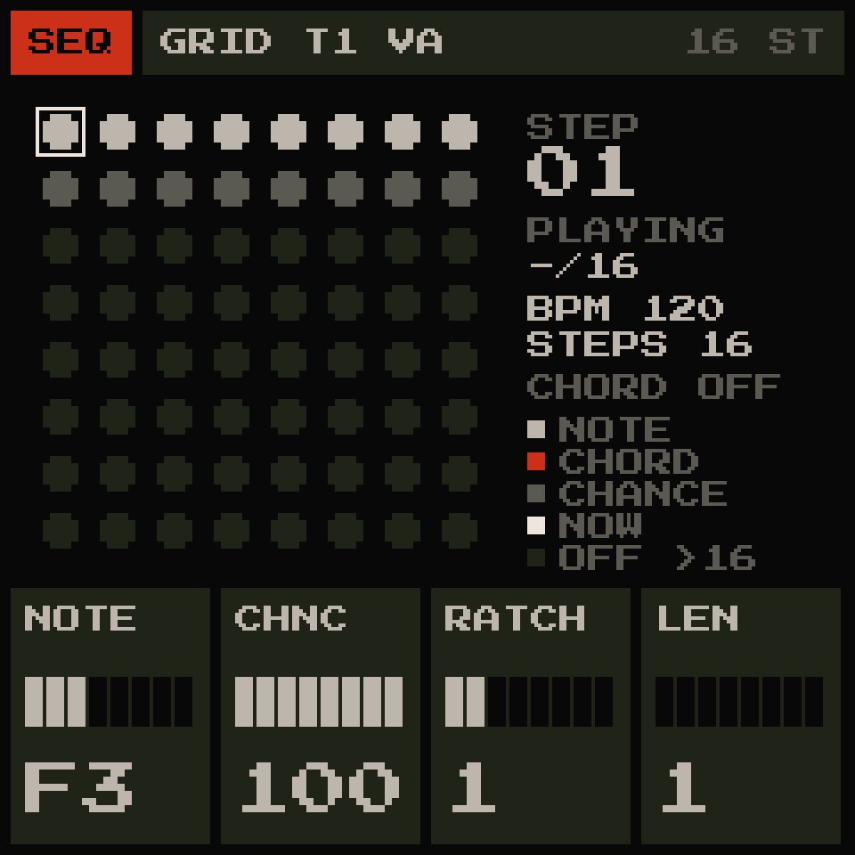

**SEQ** opens **GRID → PATTERN SETTINGS**. **PLAY/STOP** starts and stops. **REC** records.

**GRID** (the selected step):

| KNOB 1 | KNOB 2 | KNOB 3 | KNOB 4 |
|---|---|---|---|
| NOTE (all the way down = OFF) | CHANCE | RATCHET (1–4 hits) | LENGTH (in steps) |

**PATTERN SETTINGS:**

| KNOB 1 | KNOB 2 | KNOB 3 | KNOB 4 |
|---|---|---|---|
| STEPS (1–64) | DIVISION | SWING | PLAY MODE (FORWARD, BACKWARD, PINGPONG, RANDOM) |

**On the sequencer pages:**
- **SELECT** moves the cursor; **hold SEQ + turn SELECT** changes the pattern length.
- **PRESETS** sets the tempo (BPM shows in the panel on the right).

**Recording:**
- **Stopped + REC:** each key writes its note into the selected step and moves on.
- **Playing + REC:** what you play lands on the nearest step.
- With chord mode on, recorded steps keep their chord (shown in colour).
- **Hold REC** (about 1 second) clears the selected track's pattern; the screen says `T1 CLEARED`. REC stays as it was before you pressed it, so you can clear and keep recording. EDIT + OCT− brings the pattern back. A short press of REC works as always. (On the SONG page REC only arms song recording.)

**Step locks:** on the sequencer pages, **hold SEL** and the four knobs become the track's sound knobs. Turn one to lock that value to the selected step (a small mark appears). **Hold SEL + OCT−** clears the step's locks.

**Tools: hold SEQ + a white key** (selected track, all undoable):

| F3 | G3 | A3 | B3 | C4 | D4 | E4 | F4 |
|---|---|---|---|---|---|---|---|
| CLEAR | RANDOM | SHIFT ← | SHIFT → | COPY | PASTE | DOUBLE | MUTATE |

---

## 8. Slots and songs: SAVE, GLO

### Slots A–D

A slot holds the four tracks' sounds, sequences and mix. Tempo and effects are shared.

- **Hold SAVE + C4, D4, E4 or F4:** save into A, B, C or D. If the slot is already used, press the key again within 3 seconds to overwrite.
- **Hold SAVE + F3, G3, A3 or B3:** recall A, B, C or D. While playing, it switches on the next bar. Keys light up for slots that are in use.
- **SAVE → PROJECTS page:** SLOT (A–D) and ACTION (LOAD, SAVE, ERASE, NEW), confirmed with **OCT+**. NEW gives you empty tracks and patterns, and also puts the mixer back to its defaults.

### Your own sounds

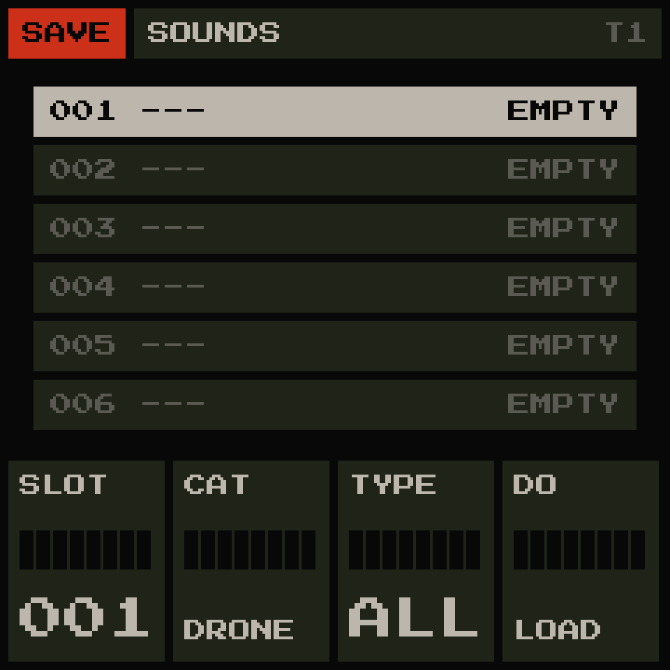

**SAVE → SOUNDS page:** 64 slots for your own sounds (source, its knobs, FM patch, ENV, LFO, latch, chord settings).

| KNOB 1 | KNOB 2 | KNOB 3 | KNOB 4 |
|---|---|---|---|
| SLOT | CATEGORY | TYPE (filters by source) | ACTION: LOAD / SAVE / CLEAR |

Confirm with **OCT+**, back out with **OCT−**. Saved sounds appear in PRESETS after the factory sounds of their category. Factory sounds can't be overwritten.

A saved sound is called by its category and number (`PAD 03`), or by the name you give it in the [editor](#15-the-editor) (up to 10 characters), on this page, in PRESETS and in HOME's header. Saving over a named sound on the FM-1 keeps its name; a sound saved into an empty slot has none until you name it.

### Song mode: GLO

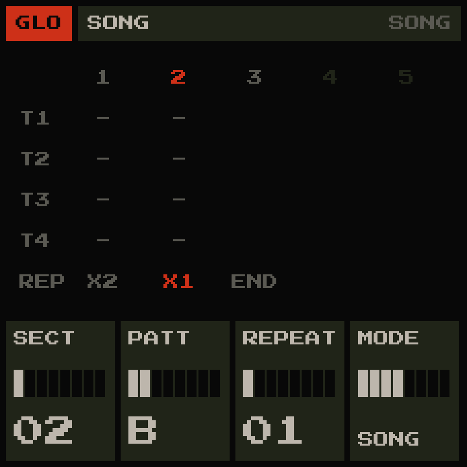

**GLO** opens the **SONG** page: a chain of up to 16 steps, each a slot and how many times it plays.

| KNOB 1 | KNOB 2 | KNOB 3 | KNOB 4 |
|---|---|---|---|
| SECTION (chain step) | PATTERN (A–D / END) | REPEATS (1–16) | MODE |

- **MODE OFF:** PLAY loops the current slot (normal).
- **MODE SONG:** PLAY runs the chain once, then stops.
- **MODE SONG LOOP:** the chain repeats.
- While a song mode is on, the header shows `SONG` on every page.
- **Record a song:** on the SONG page press **REC**, then **PLAY**, and switch slots with hold SAVE + F3–B3. The order you play is written into the chain. STOP ends it.

**Mute and solo: hold GLO + a white key.** F3–B3 mute T1–T4, C4–F4 solo T1–T4.

---

## 9. Effects: FX

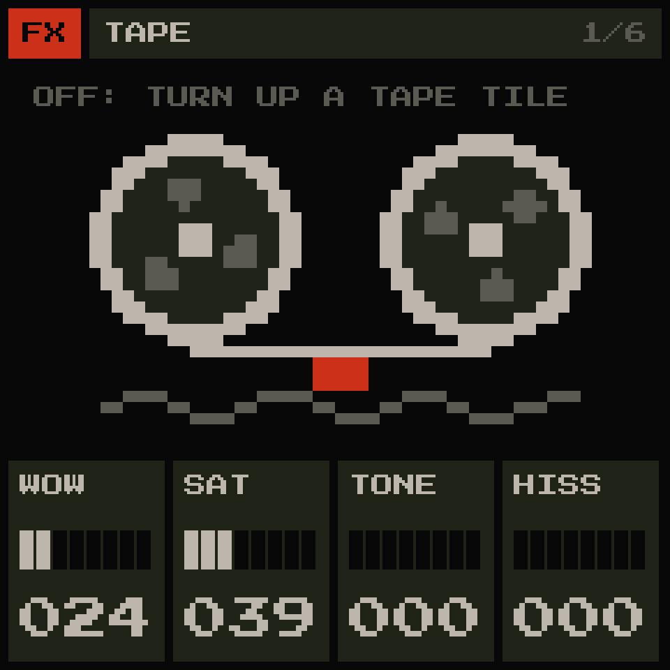

**FX** steps through **TAPE → GRAIN → DELAY → SPACE → MASTER → DRIVE**. Tracks feed GRAIN, DELAY and SPACE through their sends (MIXER 1, or FX on HOME), and MIXER 1's TAPE and DRIVE tiles send a track through a tape and a drive of its own (see [HOME](#2-home)). The tape works per track, first on the track; DRIVE and MASTER act on the whole mix.

| Page | KNOB 1 | KNOB 2 | KNOB 3 | KNOB 4 |
|---|---|---|---|---|
| TAPE | WOW (random slips) | SATURATION | TONE | HISS |
| GRAIN | SIZE | DENSITY | SCATTER | MIX |
| DELAY | TIME | FEEDBACK | WEAR | MIX |
| SPACE | SIZE (to ~32 s, then INF) | DAMP | MIX | PRE-DELAY |
| MASTER | CUTOFF | RESONANCE | TYPE (LP / HP / BP) | POSITION (PRE FX / POST REVERB / END) |
| DRIVE | AMOUNT | TYPE (SOFT / FUZZ / CLIP / FOLD) | TONE | MIX |

GRAIN and DELAY both pour into SPACE. The TAPE page sets the tape; each track's TAPE tile on MIXER 1 sets how much of that track goes through it (0 = untouched), so with every TAPE tile at 0 the tape is off completely.

- **MASTER** filters everything, in stereo. **POSITION** says where: `PRE FX` filters the tracks' dry mix before the effects return (the reverb and echoes stay bright), `POST REVERB` filters the tracks and the effects together (before DRIVE), `END` filters the very end, after DRIVE and the PERFORM tricks. `LP` with CUTOFF at the top or `HP` at the bottom switches it off completely.
- **DRIVE** distorts everything after SPACE. **AMOUNT** is how hard (0 = off completely), **TYPE** the character: `SOFT` (warm saturation), `FUZZ` (lopsided, buzzy), `CLIP` (hard), `FOLD` (a wavefolder: the harder you drive it, the more it folds back into new overtones). All four are about equally loud at the same AMOUNT, so switching TYPE doesn't jump in volume, and turning AMOUNT all the way up makes it at most ~6 dB louder. **TONE** darkens it (`OPEN` at the top), **MIX** blends it with the clean sound. A limiter after it keeps even the loudest settings from blowing up the output.
- MASTER and DRIVE belong to the project (saved with it, like the other effects); TYPE and POS belong to each track.

---

## 10. Performance: hold FX

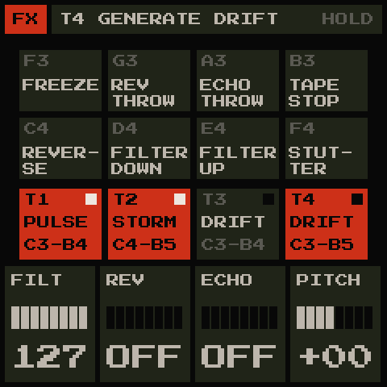

**Hold FX** for a moment and the PERFORM screen appears. Each trick lasts only while you hold its key; the sequencer keeps running underneath, and you land back in time when you let go.

| F3 | G3 | A3 | B3 | C4 | D4 | E4 | F4 |
|---|---|---|---|---|---|---|---|
| FREEZE | REV THROW | ECHO THROW | TAPE STOP | REVERSE | FILTER DOWN | FILTER UP | STUTTER |

FREEZE is the exception: tap it to hold the grain cloud, tap again to release.

### GENERATE: hold FX + a black key

A track can play by itself: random notes of the **SCALE** (with chord mode on: random chords, the track's chord on each), on the tempo (or the MIDI clock it follows, SYSTEM 2's CLOCK), whether the sequencer plays or not. It rests now and then and varies its note lengths, so it breathes, and every note gets a volume and an attack of its own. Each track has its own **MODE**, **OCTAVE** and **RANGE**.

| Hold FX + | F#3 | G#3 | A#3 | C#4 | D#4 | F#4 | G#4 | A#4 |
|---|---|---|---|---|---|---|---|---|
| | T1 | T2 | T3 | T4 | MODE | OCTAVE − | OCTAVE + | RANGE |

- **A track's key (F#3, G#3, A#3, C#4), tapped:** GENERATE on or off for that track. It switches when you let the key go, and only if you pressed no other key while holding it.
- **D#4, F#4, G#4, A#4 with a track's key held:** that track's MODE, OCTAVE or RANGE only (its on/off stays as it is). **Alone** (no track's key held): all four tracks together, all set to the same value (the next one after T1's).
- **MODE** steps through **DRIFT → PULSE → STORM**:
  - **DRIFT:** few notes, long (2–8 beats), soft, slow attacks: ambient.
  - **PULSE:** a melody on eighths, mostly on the beat, walking the scale in small steps: steadier.
  - **STORM:** dense, short sixteenths, the volume swinging wildly.
- **OCTAVE** (−3 … +3) is the generator's own, separate from the keyboard's OCT: at 0 its notes start at C3. **RANGE** (1, 2 or 3 OCT) is how far up from there it may play: OCTAVE 0 with RANGE 2 plays C3–B4.
- Every note stays in the SCALE and in the range. A chord's notes that would go past the range are folded back into it by whole octaves (they stay in the scale and the chord stays the same chord, voiced closer); two notes landing on the same pitch sound once.
- The header shows what changed for a moment: `T1 GENERATE PULSE`, `T1 GENERATE OFF`, `T2 PULSE`, `T1 OCT -1`, `ALL RANGE 2 OCT`.
- **The PERFORM screen** (FX held) shows a tile for each track under the tricks: lit while it generates, its MODE, its range (`C3-B4`), and a small square that flashes each time it plays a note.
- While FX is held, the eight black keys glow and the keys of the tracks that generate are lit.
- **The pattern:** while a track generates, its own pattern is not heard; it keeps running silently underneath, so when you switch GENERATE off it comes back in time, exactly as it was. GENERATE never writes into it.
- It plays the track's own sound through its own voices, like your keys: it never takes another track's voices (a full track skips a note). Mute and solo (GLO) work on it as usual.
- **Two or more tracks generating:** they share the six voices fairly. Each generating track gets an equal share of the voices the other tracks' keys, sequence and arp leave free (with all four generating: 2, 2, 1 and 1 voices for T1–T4), and a new note replaces that track's own oldest note (its fading tail) instead of cutting another track's. With chord mode on, a track plays as many of the chord's notes as its share holds, the root first. Keys, the sequencer and the arp keep the usual voice rules.
- **On a SAMPLE track** its notes can be much longer: from the mode's shortest up to the whole sample loop (the SOUND page's LENGTH), so you hear a sample play out instead of only its start. Other sources keep the mode's note lengths.
- Nothing is saved: after power-on GENERATE is off on every track, every track DRIFT, OCTAVE 0, RANGE 2 OCT.

---

## 11. System: hold HOME

**Hold HOME** opens **SYSTEM**; press HOME again for **SYSTEM 2**, again for **SYSTEM 3**, and again to go back to SYSTEM. These are settings for the device, not the project.

| SYSTEM | SYSTEM 2 | SYSTEM 3 |
|---|---|---|
| 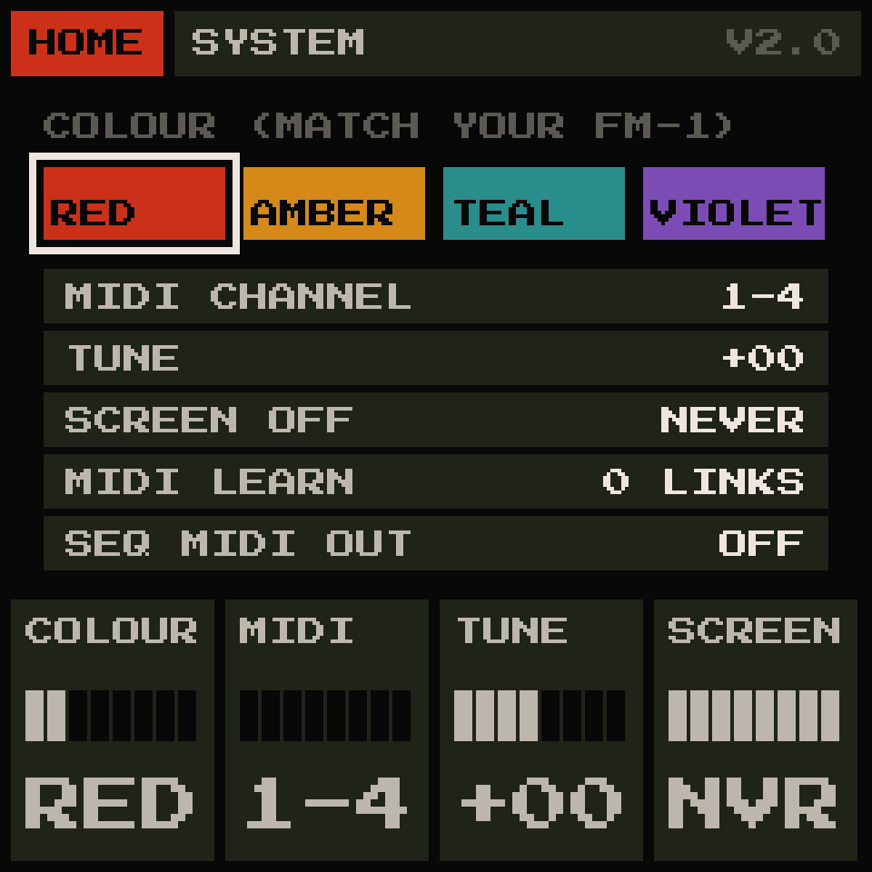 | 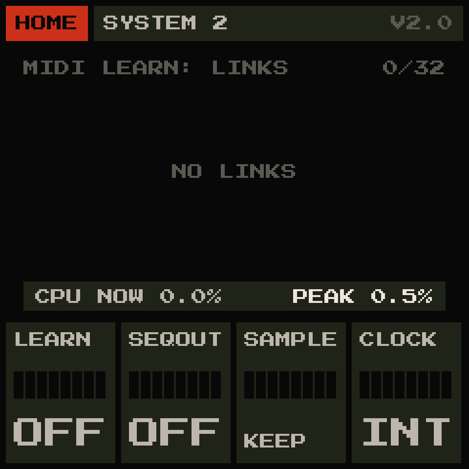 | 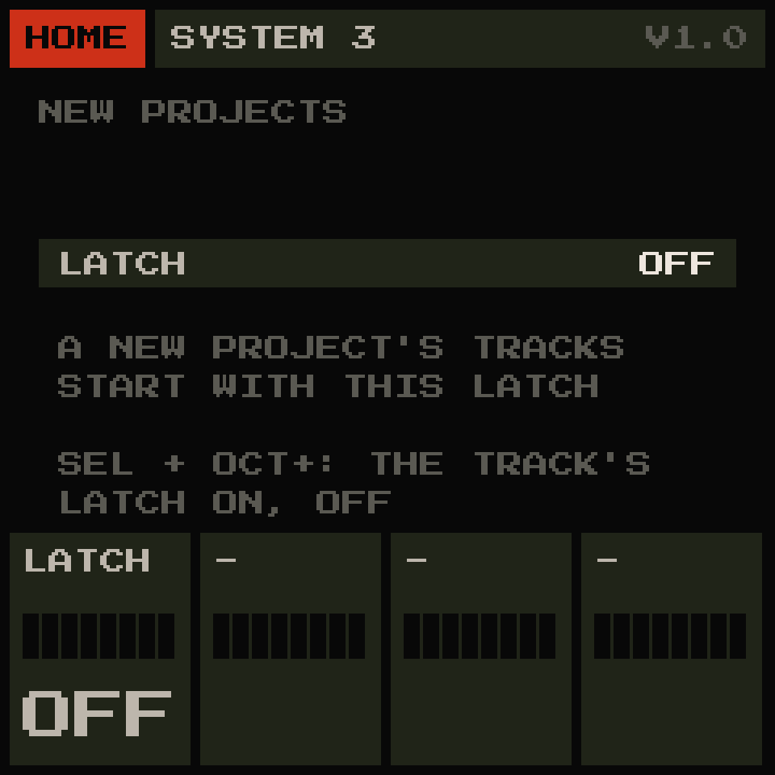 |

| Page | KNOB 1 | KNOB 2 | KNOB 3 | KNOB 4 |
|---|---|---|---|---|
| SYSTEM | COLOUR (red, amber, teal, violet) | MIDI CHANNEL | TUNE (±50 cents) | SCREEN OFF |
| SYSTEM 2 | MIDI LEARN | SEQ MIDI OUT | SAMPLES | CLOCK |
| SYSTEM 3 | LATCH | VELOCITY | – | – |

- **MIDI CHANNEL:** `1-4` puts T1–T4 on channels 1–4 (or start higher, up to `13-16`); `ALL > SEL` sends every channel to the selected track; `CH 1 > SEL` … `CH 16 > SEL` sends only that channel to the selected track and ignores the others (notes and CCs). The same for USB and the TRS jack.
- **SCREEN OFF:** the screen goes dark after the chosen time; the music keeps going. Your first touch only wakes it.
- **MIDI LEARN:** set LEARN, turn any knob on the FM-1, then move a knob on your controller. Up to 32 links. CLEAR ALL removes them (confirm with OCT+).
- **SEQ MIDI OUT:** sends the sequencer's and arp's notes out over USB on each track's channel.
- **SAMPLES:** turn it to RESTORE and press **OCT+** to write the four factory samples back into all four sample slots (a few seconds; stop the sequencer and let the sound die out first). **OCT−** keeps your samples.
- **CLOCK:** where the tempo comes from.
  - `INT`: the FM-1's own tempo (SELECT on HOME, PRESETS on the sequencer pages).
  - `INT+OUT` (`I+OUT` on the knob): the same, and the FM-1 sends MIDI clock over USB: 24 pulses a beat (also while stopped), START when you press PLAY (it starts on the next pulse), STOP when it stops. Set your DAW to follow it. The pulses are timed to the microsecond, and when you change the tempo they glide to the new one over about two beats, so the DAW follows smoothly. While the FM-1 saves your work (a couple of seconds after you stop touching it, only while stopped) the clock pauses for a moment (about 50 ms), so a following DAW may show a brief wobble then.
  - `USB` or `TRS`: the FM-1 follows the MIDI clock coming in over USB or the TRS jack. START plays from step 1, CONTINUE carries on where STOP left it, STOP stops; PLAY and STOP on the FM-1 still work (PLAY starts on the next pulse). HOME shows `EXT` and the tempo it measures; SELECT and PRESETS don't change the tempo meanwhile. The arp, song mode and slots changed "at the next bar" all follow the clock. If the clock stops for half a second, the FM-1 carries on at its own tempo.
- SYSTEM 2 also shows the processor load (CPU NOW / PEAK) and **USB REC DROPS**: how many gaps there have been in the audio sent over USB while a computer records the FM-1. Stopping or pausing the DAW also adds to it. OCT− + OCT+ together resets both.
- **LATCH** (SYSTEM 3): what loading a sound does to a track's LATCH.
  - `FROM SOUND` (`SOUND` on the knob; the default, as GR!MM 1.0): the sound brings the LATCH it was saved with.
  - `ALWAYS OFF` (`OFF` on the knob): loading a sound sets the track's LATCH off (latched notes stop), so every sound starts unlatched, whatever was saved in it. You can still latch it by hand any time, with EDIT's LATCH or **SEL + OCT+**.
  - Projects and slots A–D keep the LATCH they were saved with, and a NEW project's tracks start unlatched.
- **VELOCITY** (SYSTEM 3): `OFF` (as GR!MM 1.0): every note at full volume. `ON`: a MIDI note (USB or the TRS jack) plays as loud as it was played (soft notes much quieter). The FM-1's own keys, the sequencer and GENERATE stay at full volume either way, and so do notes the arpeggiator plays.

---

## 12. Factory sounds

Turn **PRESETS** to step through them by category, then your own.

| Category | Sounds |
|---|---|
| PAD | Crypt Pad, Ash Veil, Frozen Hall, Last Light, Moss, Black Velvet |
| DRONE | Monk Drone, Abyss, Iron Lung, Tomb Hum, Static Prayer, Deep Well |
| BELL | Iron Bell, Funeral Chime, Rust Gong, Glass Harp, Bowed Bell, Shrine |
| VOICE | Choir of Ghosts, Monks, Whisper Chorus, Vigil, Hollow Hymn, Gregorian, Plainchant, Cathedral Choir, Nuns |
| ORGAN | Funeral Organ, Chapel |
| KEYS | Dead Harpsichord, Music Box, Cathedral Keys, Bone Piano, Wraith, Lantern, Spider Pluck, Lute, Candle |
| OTHER | Haunted Strings, Dungeon Brass, War Horn, Cello Grave, Sorrow Strings |
| TEXTURE | Wind Thru Stone |

---

## 13. Combos at a glance

| Hold | + | Does |
|---|---|---|
| EDIT | OCT− / OCT+ | Undo / redo |
| FX | white keys F3–F4 | Performance tricks (FREEZE … STUTTER) |
| FX | black key F#3 / G#3 / A#3 / C#4, tapped | GENERATE on/off for T1 / T2 / T3 / T4 (on letting go) |
| FX | a track's black key held + D#4 | That track's GENERATE MODE: DRIFT → PULSE → STORM |
| FX | a track's black key held + F#4 / G#4 | That track's GENERATE OCTAVE down / up |
| FX | a track's black key held + A#4 | That track's GENERATE RANGE: 1 → 2 → 3 OCT |
| FX | D#4 / F#4 / G#4 / A#4 alone | The same for all four tracks |
| SEL | (alone, let go) | Chord mode on/off |
| SEL | a knob (sequencer pages) | Lock that value to the selected step |
| SEL | OCT− (sequencer pages) | Clear the step's locks |
| SEL | OCT+ | The selected track's LATCH on/off |
| SEQ | white keys F3–F4 | Sequencer tools |
| SEQ | turn SELECT | Pattern length |
| SAVE | F3–B3 / C4–F4 | Recall / save slots A–D |
| GLO | F3–B3 / C4–F4 | Mute / solo T1–T4 |
| ARP | (alone) | Arpeggiator on/off |
| REC | (alone, ~1 s) | Clear the selected track's pattern |
| HOME | (alone) | System settings |
| — | OCT− + OCT+ together | Reset CPU PEAK and USB REC DROPS |

---

## 14. Good to know

- **Six voices** are shared by all tracks. A track never takes a voice another track is using: when all six are busy, a new note on a track takes one of that track's own fading (released) notes; if it has none, the extra note isn't played. So a latched drone on one track keeps sounding however many keys you press on another. Only a track with no voice at all may take one, from the track holding the most, so no track is ever locked out.
- **PHYS plays at most four notes at once** (it's the heaviest source). A fifth PHYS note takes the voice of a PHYS note that is fading out (released) if there is one; only when four PHYS notes are all on (held or latched) does it take the oldest of them.
- **Looping MIDI from a DAW:** if a note arrives again before its note-off (a loop point), the note simply goes on: the arp isn't restarted, and the late note-off of the earlier one doesn't stop the new one. ALL NOTES OFF (CC 123, which DAWs send on stop) lets go of every note MIDI is holding; latched notes stay.
- **Your sounds, slots A–D, settings and samples survive firmware updates.**
- **CPU FULL: NOTE DROPPED:** the FM-1 has too much to play at once. It lets go of fading and generated notes first and keeps the notes you hold and the latched ones.
- **After an unexpected restart** the header says why for a moment at power-on: `WATCHDOG RESET` (the FM-1 froze and restarted itself) or `LOW VOLTAGE RESET` (the power supply dipped).
- **Factory sounds never switch chord mode on** when you load them. GREGORIAN, CATHEDRAL CHOIR and NUNS have their chord type set (GREGORIAN: FIFTH), so hold SEL to hear them as chords.
- **Loudness:** GR!MM 2.0 keeps 6 dB of headroom: up to three quarters of MASTER everything plays 6 dB quieter than in 1.0 (sounds and projects are unchanged, only the output), and the last quarter of MASTER brings it back up to 1.0's level. A limiter at the very end means the output never clips, whatever LEVEL, chords or DRIVE do; at the top of MASTER the loudest chords are limited a little.
- **MIDI IN:** over USB, and on the **TRS jack** (3.5 mm, MIDI IN only) with a TRS-to-DIN MIDI adapter. (TRS adapters come in different wirings; which one the FM-1's jack needs is still being tested, and this manual will say once it's confirmed.) Notes and CCs from the jack go exactly where USB's do (MIDI CHANNEL, MIDI LEARN); SysEx from the jack is ignored.
- **Samples:** load your own WAV files into the four slots with the [editor](#15-the-editor) (or, optionally, `tools/fm1_sample_upload.py`, see the README). SYSTEM 2's SAMPLES brings the factory samples back.
- **Stuck?** Use the Rescue page on the [FM-1 Firmware Hub](https://thefirmwarehub.com/).

---

## 15. The editor

**[grimmbient.github.io/grimm/editor.html](https://grimmbient.github.io/grimm/editor.html)**, in Chrome or Edge on a computer. Connect the FM-1 over USB, press **CONNECT FM-1 (USB)** and allow MIDI when the browser asks. **TRY WITHOUT AN FM-1** runs GR!MM's own code in the page instead.

- **SOUND EDITOR:** the four tracks' sounds (T1–T4), every setting on screen with the FM-1's names. Every move plays on the FM-1 at once, like turning its knobs, and in the page's own GR!MM, whose screen and keys are beside the sliders (play them with the mouse or the computer keyboard: `Z`–`/`, `S`–`'`, `Q`–`O`). **STORE IN SLOT** saves the sound into one of your 64 slots, with the name you give it.
- **SOUNDS:** your 64 slots and the 44 factory sounds; **LOAD TO T1–T4** puts one on a track. Rename, clear, import and export single sounds.
- **SAMPLES:** drop a WAV on a slot and **UPLOAD** it; **RESTORE FACTORY SAMPLES**. **NORMALISE** (on unless you untick it) brings every WAV to the same loudness; off, a sample keeps its own level.
- **FX:** the project's effects (TAPE, GRAIN, DELAY, SPACE, MASTER, DRIVE), each track's filter TYPE and POS, and each track's five sends (MIXER 1), live: **READ FROM FM-1**, then every move plays on the FM-1 at once.
- **SETTINGS:** MIDI CHANNEL, CLOCK, LATCH (FROM SOUND / ALWAYS OFF) and VELOCITY (OFF / ON), read from the FM-1 and written back (the rest of the settings stay as they are).
- **BACKUP:** one file with all your sounds, slots A–D, settings and the four sample slots, and a restore that makes a backup of what's there first. A restore puts the samples back too; a slot that already holds the same sample isn't written again, and a slot that was empty in the backup is emptied. Backups from GR!MM 1.0 (they have no samples) restore too and leave your samples as they are.

The FM-1 only writes to its memory (store, upload, restore) while the sequencer is stopped and nothing sounds; the editor tells you when to wait. Nothing is written without you pressing a button.

---

## 16. The web emulator

**[grimmbient.github.io/grimm/](https://grimmbient.github.io/grimm/)**: the FM-1's panel in your browser, running the same firmware. Press **Switch on**, then play it with the mouse or the computer keyboard. Each button shows its key in its corner.

| Key | Does |
|---|---|
| `Z X C V B N M , . /` | The white keys from F3 |
| `S D F H J L ; '` | The black keys |
| `Q W E R T Y U I O` | B4 to G5 |
| `1 2 3 4 5 6` | FX, SCL (SEL), ENV, LFO, EDIT, GLO |
| `7 8 9 0 - =` | HOME, SAVE, ARP, SEQ, PLAY, REC |
| `[` `]` | OCT−, OCT+ |
| `↑` `↓` | SELECT |
| `←` `→` | ALGORITHM (the track) |

**Combos:** hold a button's key and press other keys, as on the FM-1 (for example hold `8` for SAVE and press `Z`). With the mouse, right-click or Shift-click a button to keep it held until you click it again. Drag or scroll a knob to turn it.

**MIDI in:** the web emulator plays notes and CCs from a MIDI keyboard or controller through Web MIDI (pick the input under the panel). It has no MIDI clock: CLOCK USB / TRS and INT+OUT only work on the FM-1 itself.
